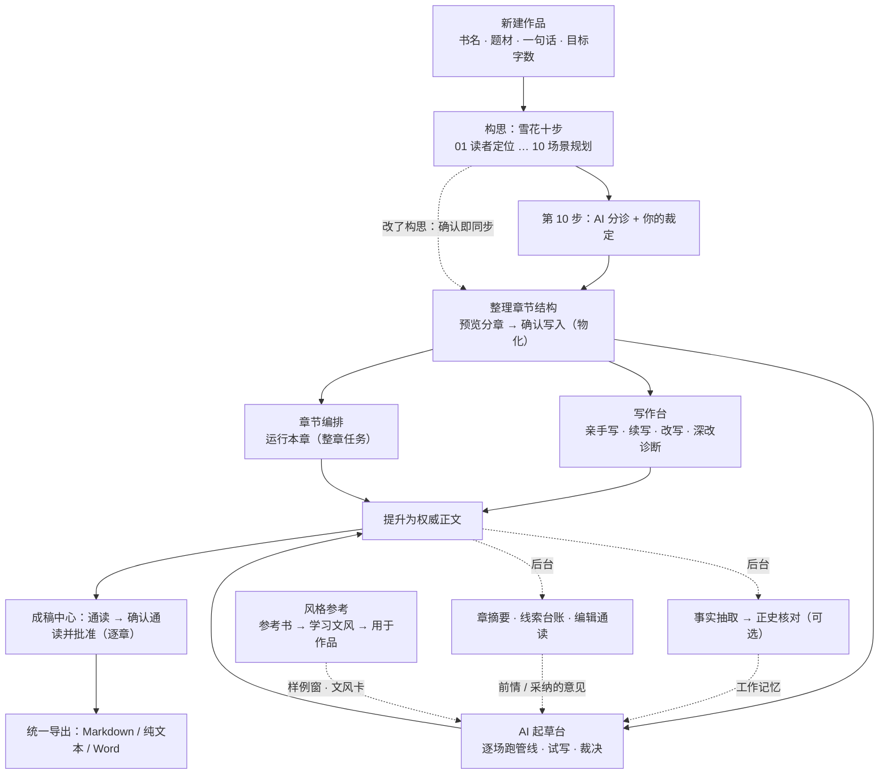
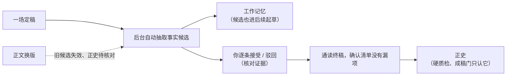
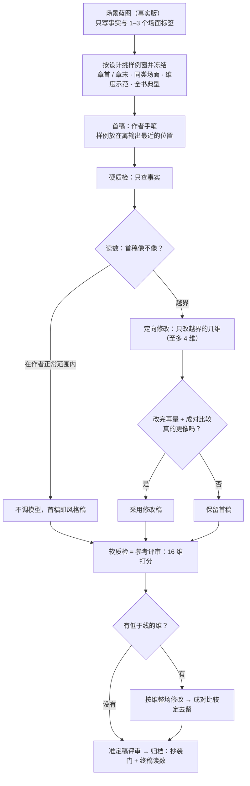

# AI 小说创作系统 · 用户手册

> 适用于正式 React 工作台（`frontend-react/`）与它背后的后端，按 2026-10-19 的主线代码核对。
> 这份手册是**从头读到尾的一本书**：先讲系统为什么这样设计，再按创作顺序把每一个页面、每一个按钮讲清楚，最后是数据安全、
> 排障与参考表。[操作手册](operator-manual.md)是同一套功能的速查版；各模块更细的技术契约见文末「延伸阅读」。
> 手册与代码不一致时以代码为准，并回头改这份手册。

---

## 目录

**第一部分 · 认识这个系统**

1. [它是什么，不是什么](#1-它是什么不是什么)
2. [贯穿全系统的设计原则](#2-贯穿全系统的设计原则)
3. [核心概念与术语](#3-核心概念与术语)
4. [一本书在系统里的一生](#4-一本书在系统里的一生)

**第二部分 · 安装、接入模型与界面**

5. [安装、启动与停止](#5-安装启动与停止)
6. [接入模型：设置 · AI 模型](#6-接入模型设置--ai-模型)
7. [界面总览](#7-界面总览)

**第三部分 · 创作主线（按页面）**

8. [新建作品与主页](#8-新建作品与主页)
9. [构思：雪花十步](#9-构思雪花十步)
10. [整理章节结构：分章面板](#10-整理章节结构分章面板)
11. [章节编排](#11-章节编排)
12. [写作台](#12-写作台)
13. [AI 起草台](#13-ai-起草台)
14. [成稿中心](#14-成稿中心)
15. [风格参考](#15-风格参考)
16. [等你处理：主页卡片与侧栏角标](#16-等你处理主页卡片与侧栏角标)
17. [资料（故事圣经）](#17-资料故事圣经)
18. [规则诊断：20 个维度](#18-规则诊断20-个维度)
19. [成本看板](#19-成本看板)
20. [删除、回收站与作品管理](#20-删除回收站与作品管理)

**第四部分 · 质量、安全与数据**

21. [不丢字：保存、冲突与「同步与恢复」](#21-不丢字保存冲突与同步与恢复)
22. [质量分级与各道闸门](#22-质量分级与各道闸门)
23. [后台任务与恢复](#23-后台任务与恢复)
24. [网络、令牌与密钥](#24-网络令牌与密钥)
25. [数据库：备份、升级、压缩与重置](#25-数据库备份升级压缩与重置)

**第五部分 · 参考**

26. [常见问题与排障](#26-常见问题与排障)
27. [常见错误码](#27-常见错误码)
28. [环境变量（作者会碰到的）](#28-环境变量作者会碰到的)
29. [快捷键](#29-快捷键)
30. [有意不做的事](#30-有意不做的事)
31. [延伸阅读](#31-延伸阅读)

---

# 第一部分 · 认识这个系统

## 1. 它是什么，不是什么

这是一套**单机、单作者**的长篇小说创作系统。它陪你把一个念头一路写成一本书：

```
新建作品 → 雪花十步构思 → 整理成章与场 → 逐场 AI 起草或亲手写 → 你复核并提升为权威正文 → 成稿中心通读、批准终稿 → 导出
```

一路上它还替你记住故事里已经发生的事（正史与故事记忆）、提醒你哪里写得不像自己想要的样子（诊断）、
帮你模仿一位参考作者的手笔（风格参考），并把每一次模型调用记在账上（成本看板）。

它**不是**：

- **多用户 SaaS**：没有账号、权限和租户。远程访问只是一道共享令牌，不是登录（见第 24 节）。
- **高可用服务**：后台任务跑在后端进程里的线程池上，重启后能接着跑，但不是分布式队列。
- **出版裁决器**：所有评分、分诊、诊断都只是提示，拍板的永远是你。规则诊断不等于出版质量，抄袭门也不能代替版权清查。
- **离线写作机**：没有接好模型时，任何「生成」都不会给你一段假文字，而是明确告诉你去哪里接模型（第 2.2 节）。
- **跨设备备份**：浏览器里的恢复记录只在这一台电脑、这一个浏览器里；真正的备份是停机后的数据库备份（第 25 节）。

## 2. 贯穿全系统的设计原则

后面每一个页面的「为什么这样」几乎都能追到下面几条。读懂它们，遇到没写到的情况也能猜出系统会怎么做。

### 2.1 作者拍板，AI 只提议

- AI 生成的东西永远先是**候选**：起草台的 AI 稿不会自动覆盖你的正文，写作台的续写和改写要你点「采纳」，抽出来的事实要你核对才算正史。
- 有几类决定**只有你能做**，模型连建议都不许给：场景「待删」、场景的「破例理由」、终稿批准、重开终稿的原因。
- 分诊、验收门、诊断都是**指南不是锁**：验收门没过也可以「确认本步」，规则层只拦「缺失」和「占位」，质量判断一律降为「建议」。

### 2.2 拒绝式：没有模型就说没有，绝不编

每一个生成节点都是 **fail-closed**：没有可用模型时返回 409 并带一条 `author_action`（界面上就是「去系统配置」之类的按钮），
供应商出错时返回 502。系统里没有演示作品、没有离线桩生成、没有「规则冒充 AI」的兜底，风格参考的分类与学习也不会退回启发式。
你看到的每一段 AI 文字，都是真的由你配置的模型写的。

### 2.3 一件事只有一个真相源

长篇最怕「这里改了一版、那里还是另一版」。系统刻意让每类事实只在一处可写：

| 事实 | 唯一的来源 | 其他地方 |
|---|---|---|
| 场的先后（故事序） | 构思第 9 步「场景列表」的行序 | 分章面板、目录、台子都只读它 |
| 哪几场归哪一章、章的先后与幕 | 分章面板（「整理章节结构」） | 07 的章节表是只读镜像；章节编排里的同一张面板是「第二扇门」 |
| 章名 | 一个名字，两扇门（分章面板、章节编排） | 改哪边两边一起变 |
| 雪花场的设计（形态、三拍、POV、钩子……） | 构思第 9 / 10 步 | 台子上只读，带「在构思里改」直达 |
| 台子能知道的一切 | 目录（catalog）载荷 | 写作台、AI 起草台、章节编排读同一份 |
| 一场的诊断 | 一份诊断记录（稳定的 signal id） | 写作台深改、成稿中心的通读与跨章、成稿门都认同一条、同一次「忽略」 |
| 原文重合检查 | 唯一抄袭门 | 每条进正文的路径都过它 |
| 风格绑定怎么用 | `StylePolicy` 一处判断 | 起草、评审、规划都问它 |

### 2.4 设计必须到达写作

你在构思里写下的东西，不是写完就躺在构思页里。第 9、10 步的形态、坩埚、三拍、代价，起草、蓝图、硬软质检、准定稿评审都能看到
带标签的版本（「场景结构」段，永不压缩）；已确认的一句话、一段话、人物表、视角故事、章表与相邻两场经「设计背景」段到达起草。
反过来，系统**不替你编**：你没写的坩埚、三拍、钩子，物化时不会用样板句冒充，空就是空（显示为「未规划」）。

### 2.5 留白即合法，回溯是廉价的

- 原著的人物表满是「尚未定义」：只有主角和对手要求完整，配角留白不是缺陷，编造才是。未确认的上游草稿是你的工作稿，模型不得替你补满。
- 改上游不会毁下游：下游已确认的步骤只是亮起「需复核」，你可以看上游改了什么、按新上游重新展开，或点「已复核」。
  物化之后再改 01 / 02 / 03 / 05，已有的草稿、质检、终稿全部保留，新设计在下一次起草时自然到达。
- 删除都是软删除（回收站可恢复）；构思每一步都有服务器保存的历史版本；整步清空会另存一版。

### 2.6 永不越改越远

AI 的每一次「再改一下」都要证明自己更好才被留下：风格定向修改改完再量，不更像就保留首稿；补丁要过「成对比较」（同一个评审把两版放在一起、
换一次先后各问一次，两次都说同一边更像才算数）；准定稿改写稿若带进新的安全问题或读数变远，就丢掉改写稿、保留来源稿。

### 2.7 候选与权威分开

| 候选 | 权威 |
|---|---|
| AI 稿、续写候选、改写候选 | 你提升过的**权威正文** / 归档的终稿 |
| 模型抽出的事实候选（「工作记忆」） | 你核对完成的**正史** |
| AI 写的章节蓝图、场景蓝图 | 你改写过的「我的版本」 |
| 评审分、读数 | 你自己读出来的判断（数字与你读的相反时，以你读的为准） |

候选可以被大方地用（比如没核对的事实候选也进后续起草的提示词），但只有权威那一列能拦下东西（硬质检、成稿门只认正史）。

### 2.8 不丢字

你写下的每一个字，在任何一种失败下都有地方可找：存不上的留在本机并自动重发；和另一台设备冲突时两边的字都留着；
覆盖之前先备份；构思在读不到服务器时暂停上行，免得空白稿盖掉服务器上的版本。详见第 21 节。

## 3. 核心概念与术语

| 术语 | 含义 |
|---|---|
| **作品** | 一本书。所有构思、章、场、正文、资料都按作品隔离。 |
| **雪花十步** | 构思的骨架，来自 Randy Ingermanson 的雪花写作法：读者定位 → 一句话 → 一段话 → 角色摘要表 → 一页梗概 → 角色背景 → 长篇大纲 → 角色全档案 → 场景列表 → 场景规划。 |
| **硬闸门** | 物化（整理成章与场）之前必须确认的五步：01、02、03、09、10。其余缺了只提醒。 |
| **主动场 / 反应场** | 场景的两种形态。主动场：目标 → 冲突 → 挫折；反应场：反应 → 两难 → 决定。合称一场的**三拍**。 |
| **坩埚** | 把视角人物困在这一场、让他不能一走了之的力量。每场必填。 |
| **次要三拍** | 一场在主三拍之后紧接的另一组三拍（如主动场的挫折之后紧跟反应、两难、决定），这一场以最后一拍收尾。 |
| **呈现方式** | 完整场 / 概述两段（两种形态都可以）/ 略过（只限反应场：三拍照写，但不建场景卡，三拍并入下一场的设计背景）。 |
| **破例理由** | 这一场故意不按三拍走时你写下的理由；写了，系统就不再把缺的三拍算缺失。只有你能写。 |
| **分诊** | 设计期（第 10 步「AI 分诊」+「你的裁定」）与写完后（场景三问）判断一场是否立得住。 |
| **章表 / 分章** | 哪几场归哪一章。章是场景列表上**连续的一段**，只在分章面板里改。 |
| **物化** | 分章面板里点「确认写入」：把构思落成目录里真实的章（ChapterGoal）和场景卡（SceneCard）。 |
| **目录（catalog）** | 全书的章 → 场结构，写作台、AI 起草台、章节编排读的是同一份。 |
| **书脊** | AI 起草台和写作台左侧的全书章 → 场列表，与目录同源。 |
| **设计卡** | 一场的整张设计（坩埚、POV、时空、出场、三拍、离场变化、钩子、读者感受、代价、必须包含 / 隐瞒、章摘要），三张台子共用。 |
| **作者稿** | 写作台里这一场你正在写的稿，自动保存到服务器。 |
| **权威正文 / 终稿** | 你提升（或 AI 稿归档）之后成为这一场权威版本的文字；成稿中心、导出、正史都以它为准。 |
| **终稿批准** | 成稿中心里对一整章「读过并定稿」的唯一动作，绑定你读到那一版正文的哈希。 |
| **正史** | 你核对完成、能追溯到当前终稿的故事事实。硬质检与成稿门只认它。 |
| **工作记忆** | 正史 + 还没核对的事实候选（你驳回的不算）。起草提示词读它。 |
| **故事记忆** | 每章的 AI 章摘要、全书的线索台账、每三章一次的编辑通读。 |
| **章节蓝图 / 场景蓝图** | 起草前 AI 对一章 / 一场「怎么演」的理解；场景蓝图在起草台叫「AI 写前笔记」。都可以改写成「我的版本」。 |
| **参考书 / 文风卡 / 文风画像** | 你想学其文风的一本书；学出来的 16 维文风卡与声音习惯、尺度、禁用词合称文风画像。 |
| **绑定** | 把一份文风用于一部作品（或一场、一个角色）。 |
| **样例窗** | 起草时随提示一起发给模型的参考书原文片段，每场按设计挑一次、冻结。默认 12 窗。 |
| **像不像（读数 / 百分位）** | 把参考作者自己书里的段落按「像不像作者本人」排成 100 位，看一段文字落在第几位；越低越像，落在作者的正常范围里算像。 |
| **抄袭门** | 与参考书原文连续 12 字以上相同的文字不能进正文，唯一会拦下正文的风格检查。 |
| **受保护专名** | 参考书里的人名、地名、组织与作者自造的词；起草时要求避开，用到只提醒、不拦。 |
| **发现（finding）** | 诊断里的一条问题，带稳定 id、中文说明、改法和钉到段落的证据。 |
| **Q0–Q3** | 质量分级：Q0 / Q1 阻断归档（正文保留），Q2 醒目警告，Q3 只进诊断（第 22 节）。 |
| **模型服务 / 节点 / 分工 / 路由** | 服务 = 一个接入的供应商账号；节点 = 一种 AI 功能（如「初稿」「软质检」）；分工 = 把节点分成三班岗批量指派；路由 = 某个节点最终用哪个服务的哪个模型。 |
| **author_action** | 后端拒绝一件事时附带的「下一步该做什么」，界面上显示成按钮。 |
| **作家模式 / 高级模式** | 侧栏底部的切换，只改变可见入口，不改变数据与生成结果。 |

## 4. 一本书在系统里的一生



几条要点：

- **构思是上游，目录是交接面**：物化之后再改第 9 / 10 步，点「确认本步」那一刻目录里的场景卡就跟上（确认即同步）；台子上不另改设计。
- **三张台子任选**：写作台适合亲手写和局部借力；AI 起草台适合逐场让 AI 写、看清每一步；章节编排的「运行本章」适合整章交给后台。
  三者读同一份目录、写同一份作者稿，可以混着用。
- **定稿不等于核对完正史**：批准只要求每一场都有权威正文、你读过当前正文；正史核对是可选的纠错，不拦批准和导出。
- **记忆是自动长出来的**：每场定稿后后台抽事实，每章写完后写章摘要，每三章做一次编辑通读，后面的章起草时都读得到。

### 4.1 第一次使用的建议路线

1. **启动并接模型**（第 5、6 节）：`scripts/start-all-linux.sh` → 打开 `http://127.0.0.1:5174` → `设置` → `AI 模型` → 添加一个服务 →
   在「模型分工」里给三班岗选好模型 → `应用分工`。接入状态显示全部就绪再往下走。
2. **新建作品**（第 8 节）：书名、题材、一句话、目标字数。
3. **构思前三步**（第 9 节）：01 读者定位、02 一句话、03 一段话。每一步可以自己写，也可以 `先看 3 个方向` 挑一个 `按此生成本步`；满意就 `确认本步`。
4. **其余步骤按需**：04–08 可以先粗写或带原因略过，以后随时回来补（改上游不会毁下游）。
5. **场景列表与场景规划**（9.6）：先列场、定形态与坩埚，再写三拍；`AI 分诊` 后给出你的裁定。
6. **整理章节结构**（第 10 节）：预览分章、`AI 起章名`、`确认写入`。
7. **先试写一场**（13.4）：切到高级模式 → `AI 起草台` → 点第一场 → `先试写`，读一读手感，满意再 `继续跑完`。
8. **想要某位作者的手笔**（第 15 节）：`风格` → 导入参考书 → 学习文风 → 用于作品，再回起草台起草。
9. **一章写齐后定稿**（第 14 节）：`成稿中心` → 通读 → `确认通读并批准`。


---

# 第二部分 · 安装、接入模型与界面

## 5. 安装、启动与停止

### 5.1 环境

- Python 3.12，用 [uv](https://docs.astral.sh/uv/) 装锁定的虚拟环境（不要用系统 Python）。
- Node.js ≥ 20.19（推荐 22）与 npm。仓库根目录不是 Node 项目，不要在根目录装 npm 包。

首次安装：

```bash
cd backend && uv sync --locked --extra dev && cd ..
cd frontend-react && npm ci && cd ..
```

### 5.2 启动与停止

| 平台 | 启动 | 停止 | 说明 |
|---|---|---|---|
| Linux | `scripts/start-all-linux.sh` | `scripts/stop-all-linux.sh` | 日志与进程号在 `.codex-run/`；启动会等 `/ready` 通过，失败时打印日志末尾 |
| Windows | `.\start-dev.cmd` | `.\stop-dev.cmd`（重启 `.\restart-dev.cmd`） | 端口被占用时往上找空端口，实际地址写进 `.codex-run/backend.url` / `frontend-react.url`，并自动打开浏览器 |

启动脚本每次都先执行数据库升级（`alembic upgrade head`），再启动后端与前端；生产启动链路从不注入测试夹具或演示作品。
Node 太旧、找不到 node / npm 或缺 `node_modules` 时，脚本**在停掉任何服务之前**就说明该装什么并退出，正在跑的服务不受影响。

默认地址：

| 地址 | 用途 |
|---|---|
| `http://127.0.0.1:5174` | React 工作台（你日常打开的页面） |
| `http://127.0.0.1:8000` | 后端 |
| `http://127.0.0.1:8000/live` | 存活检查：进程活着 |
| `http://127.0.0.1:8000/ready` | 就绪检查：数据库连得上、迁移版本对、必需的表和列都在 |

Linux 上前端默认**先构建再用 `vite preview` 提供**（压缩、带哈希的文件可长期缓存，隔着远程隧道打开页面快得多）。
所以前端代码更新后要重跑前端启动脚本（`scripts/start-frontend-linux.sh`）才生效；开发前端时用 `NOVEL_SYSTEM_FRONTEND_MODE=dev` 启开发服务器。

### 5.3 「数据库结构需要升级」

后端是热重载的：代码一更新就加载新代码，而数据库还停在旧版本。这时每个 `/api/*` 请求都会得到 503
「数据库结构需要升级：请重启后端（启动脚本会自动升级）」。重跑启动脚本即可（它会先升级再启动）。
反过来，提示「数据库结构比这份代码新」说明你换回了旧代码，请换回与数据库匹配的版本。
任何「database operation failed」类的报错，先打开 `/ready` 看一眼——版本不一致会直接写在那里。

## 6. 接入模型：设置 · AI 模型

没有接入模型时，系统里的一切「生成」都会拒绝并引导你来这里。打开 `设置` → `AI 模型`，从上到下四块：

### 6.1 接入状态

一句话告诉你「几个 AI 功能就绪、几个没有指派」，没就绪的按原因分组、说人话，每组给一个一步就能修的按钮
（例如「去模型分工」「一键补齐路由」）。

如果后端设置了管理令牌（`NOVEL_SYSTEM_ADMIN_TOKEN`），这里会要你填一次：保存服务、改分工都要用到，它只存在这个浏览器会话里。
没设管理令牌时，只有本机（回环地址）来的请求能改配置。

### 6.2 模型服务

点 `添加模型服务`，选一家厂商或接入方式（国内厂商、国际厂商、第三方中转、本地模型、自定义），然后填：

| 栏 | 说明 |
|---|---|
| 服务标识 | 你在本系统里给它起的名字（如 `my-deepseek`），保存后不能改；同一家厂商可以接多个账号 |
| 接口地址 | API 的 base URL；第三方中转填它给你的地址 |
| API 密钥 | 只加密保存在后端，不进浏览器缓存；编辑时留空表示沿用现有密钥 |
| 模型列表 | 一行一个；分工和路由只能从这里选。「拉取模型」会自动获取（服务不返回列表时手动填） |

每张服务卡片上有 `启用`、`测试连接`、`设为默认`、`编辑`、`删除`。删除服务会连同密钥一起从后端删掉，还指向它的 AI 功能变成未就绪。

> **密钥的加密钥匙**：保存的 API 密钥用 `NOVEL_SYSTEM_CONFIG_SECRET` 加密，启动脚本第一次运行时把它生成在
> `.codex-run/config.secret`（权限 0600）。**丢了这个文件，界面里保存过的每一个密钥都解不开**（卡片上显示「密钥解不开」），
> 只能重新填写。备份时把它一起备份。

### 6.3 模型分工：三班岗

不用逐个功能配置：系统把所有 AI 功能分成三班岗，每班选一个服务和模型，点 `应用分工` 立即生效。

| 分工 | 管什么 | 典型节点 |
|---|---|---|
| **写作主力** | 续写、初稿、风格化、改写与构思生成 | 初稿、风格稿、风格修补、文学改写、场景蓝图、人物压力蓝图、章节故事架构、写作台 · 段落修补、构思 · 生成本步 / 教练 / 场景分诊 / 分章建议 |
| **审稿质检** | QC、验收评审、文学评估与写作者诊断 | 硬质检、软质检（也是风格参考的评审）、准定稿评审、写作台 · 深度审读 / 修改提案、故事记忆 · 编辑通读 |
| **提炼整理** | 资料抽取、风格画像与项目级提炼 | 通用抽取（正史事实）、故事记忆 · 章摘要、构思 · 方向候选、参考书的分类 / 四层抽取 / 写文风卡 / 识别专名 / 打标签 |

应用分工会改写这一班里每个 AI 功能用的模型，包括你在高级路由里单独调过的那些（应用前会确认）。

**怎么选模型**：写作主力决定文字质量，值得用最好的模型；审稿质检要长上下文和判断力；提炼整理量大、要稳定的结构化输出，
可以用快而便宜的模型（参考书段落分类的大批量部分本来就分给快模型）。

### 6.4 高级路由

按分工列出**每一个** AI 功能实际用的服务与模型（只看不改），行尾写着没就绪的原因。两条规则：

- 默认参数（温度、输出预算、推理档位）只写在代码的节点注册表里；你保存的配置只记「每个节点选了哪个服务、哪个模型」。
  所以发布里修好的默认值会直接生效，你的选择一个不丢。
- 在一个配置过的安装上，新版本加了新节点而你还没给它路由时，它会拒绝运行（`LLM_ROUTE_NOT_CONFIGURED`），直到你点 `一键补齐路由`。
  一键补齐只填缺失、解析不了或没就绪的路由，不动你已经选好的；已删除节点留下的路由也会在补齐 / 分工时清掉。

> 个别中转的思考 token 特别多、默认输出预算不够时，运维可以用
> `python -m novel_system.tools.raise_llm_output_budget --node <节点> --floor <数> --execute` 为单个节点写一个显式下限，一般用不到。

## 7. 界面总览

### 7.1 侧栏与两种模式

工作台默认进入 `主页`。侧栏底部切换 `作家` / `高级` 模式——切换只改变**看得见哪些入口**，数据和生成结果完全一样。
直接打开高级视图的链接时，工作台会自动切到高级模式。

| 分组 | 入口 | 模式 | 一句话 |
|---|---|---|---|
| 日常写作 | 主页 | 作家 | 今天从哪一场写起；全书各章所在阶段 |
| | 构思 | 作家 | 雪花十步、场景分诊、整理章节结构 |
| | 写作 | 作家 | 写作房间：亲手写、AI 续写 / 改写、深改诊断、提升权威正文 |
| | 风格 | 作家 | 参考书 → 学习文风 → 用于作品，外加对照检查、配置对比 |
| | 资料 | 作家 | 人物、地点、机构、物品、概念、世界、大事记 |
| 生产与质控 | 章节编排 | 高级 | 卷 → 章 → 场的结构、章的说明与章节蓝图、运行本章 |
| | AI 起草台 | 高级 | 逐场跑生成管线，看清每一步 |
| | 成稿中心 | 高级 | 通读、批准终稿、正史、故事记忆、跨章检查、导出 |
| 运维工具 | 成本看板 | 高级 | token 用量与（写了单价的模型的）费用 |
| 系统（固定在底部） | 设置 | — | 项目、AI 模型、外观、数据与安全 |
| | 回收站 | — | 删掉的场、章、整部作品在这里找回 |

侧栏底部另有：`同步与恢复`（第 21 节）、昼夜主题按钮、`排版与舒适度` 快捷面板。

### 7.2 命令面板

按 `Ctrl+K`（macOS 为 `⌘K`）打开。可以跳到任何页面、任何一场（不输入时列出前几场，在写的排前面；输入后在全书找）、
雪花的任何一步，或执行一个动作。支持拼音 / 英文检索（如输入 `xiezuo` 找到写作）。

### 7.3 作品切换器与书架

顶部的作品切换器列出所有作品（书架），可以切换、`新建作品`、把一部作品移到回收站。切换作品时各页面自动跟上，
每部作品的数据完全隔离。至少要保留一部作品。

### 7.4 外观与舒适度

`设置` → `外观` 是完整入口，侧栏底部的 `排版与舒适度` 是同一份设置的快捷面板：

| 设置 | 选项 |
|---|---|
| 主题 | 白昼 / 暮色 / 夜灯 |
| 稿纸纹理、动效 | 动效：关 / 轻 / 标准（容易晕的话选「关」） |
| 写作台布局 | 书桌三栏 / 沉浸稿纸 |
| 专注与协作 | 柔和专注（关 / 轻 / 中 / 深）、当前行氛围光、打字机滚动、AI 候选位置（底部托盘 / 右侧抽屉） |
| 稿纸排版 | 稿纸宽度、正文字号、行距（紧凑 / 标准 / 宽松） |
| 工作台 | 证据栏密度（疏朗 / 紧凑）、运行记录默认展开 |

### 7.5 窗口宽度

所有页面的版式切换点落在同一套刻度上（宽 1440 / 1280 / 1100 / 900 / 640，矮 820）。窄屏时右栏会收成抽屉（点 ⓘ 或「上下文」打开），
构思在 900 以下收起十步列表（用页脚的上一步 / 下一步或 `Ctrl+K` 翻步），写作台在 1100 以下把章节大纲收起（点「大纲」叫出来）。

---

# 第三部分 · 创作主线（按页面）

## 8. 新建作品与主页

### 8.1 新建作品

作品切换器 → `新建作品`，填：

| 栏 | 说明 |
|---|---|
| 书名（必填） | 显示在书架、主页和导出的成稿里 |
| 题材 | 如「悬疑长篇」 |
| 一句话简介 | 说清这部作品是关于什么的；也可以之后在雪花里再写 |
| 目标字数 | 全书篇幅目标；分章时「每章约几场」的默认值会参考它 |
| 主色 | 石青、苔绿、暮金、潮红……只影响界面点缀 |

新作品是真实的后端项目，**没有任何预置的人物、剧情或候选种子**——一张白纸。之后在 `设置` → `项目` 里可以改书名、题材、简介、
目标字数和**每日目标**（主页「今日」进度条的分母）。

### 8.2 主页

主页回答一个问题：**今天从哪一场写起**。

- **现在该写的一场 / 上次写到这里**：点 `接着写` 直接落在那一场（规则见 10.8「现在该写哪一场」）。
- **今日写作目标**：今天写了多少字、离每日目标还差多少；连写天数。
- **全书进度 / 全书各章所在阶段**：一条横向的书脊，每章一格，颜色是章的阶段（待写、规划中、写作中、草稿、等你批准、已定稿），
  格上是场景计数；点一章去章节编排或写作台的大纲。
- **等你处理**：被管线停下的 AI 稿、写齐了等你批准的章，最多列四行，点一行直达处理它的那一页（第 16 节）。
- **诊断待改**：写作台深改面板里还开着的诊断发现数（忽略过的不算）。
- **起步清单**（新作品）：开始雪花构思、设定风格基调、建立资料库、配置模型。
- 后端连不上时主页说「当前离线，正在使用本机缓存」，你的本机内容仍可继续使用。

> 主页的章阶段、成稿中心的章状态、章节编排的章状态用的是**同一条判定规则**，三处不会说法不一。

## 9. 构思：雪花十步

### 9.1 设计思路

构思页是 Randy Ingermanson 雪花写作法的实现：从一句话出发，一层层展开成人物、梗概、大纲，最后落到每一场的三拍。系统坚持原著的三点：

1. **指南而非规则**：步骤可跳、可回退、可改顺序。验收门是自检清单，不是锁。
2. **提示词、归一化、诊断说同一句话**：要求「五句」，生成就只给五句、多了拒绝重试一次（不偷偷截断），诊断也按五句判。
3. **设计必须到达写作**：你在第 9 / 10 步写下的每一格，起草和质检都看得到。

### 9.2 十步一览

| 步 | 名称 | 写什么 | 闸门 |
|---|---|---|---|
| 01 | 读者定位 | 类型、读者画像、核心快感、快感来源、期待读者情绪、**叙述人称与时态**、反向定位（不写给谁） | 硬闸门 |
| 02 | 一句话概括 | 约 40 个汉字：主角、目标、阻力 / 转折；不透露结局 | 硬闸门 |
| 03 | 一段话概括 | 恰好五句：铺垫、三次灾难、结局；外加**道德前提**（在第二个灾难处，错误信念翻转为正确信念） | 硬闸门 |
| 04 | 角色摘要表 | 每个角色的定位、目标、抱负、价值观（「没有什么比___更重要」，2–3 条且互相有张力）、冲突、顿悟、一句话 / 一段话故事线；可指定全书主角 | 建议 |
| 05 | 一页梗概 | 恰好五段：03 的五句各扩一段 | 建议 |
| 06 | 角色背景 | 每个角色的信念、旧伤、欲望、恐惧、关系、**视角故事**（从他的视角讲一遍故事） | 建议 |
| 07 | 长篇大纲 | 恰好五段，每段约一页（600–1000 字）；下面的章节表是分章结果的**只读镜像** | 建议 |
| 08 | 角色全档案 | 生理 / 性格 / 环境 / 心理四维 | 建议 |
| 09 | 场景列表 | 一行一场：视角人物、一句话摘要、形态（主动 / 反应）、地点、坩埚、功能、脊柱（灾一 / 灾二 / 灾三） | 硬闸门 |
| 10 | 场景规划 | 每一场的三拍与细节（见 9.6） | 硬闸门 |

「硬闸门」的五步是物化（整理成章与场）之前必须确认的；其余步骤缺了只提醒。必填步不能「略过」；非必填步可以 `略过此步` 并写原因，
略过的步骤视为已满足、带着原因进入下游上下文。

**留白即合法**：04 / 06 / 08 只要求主角与对手完整，配角留白不是缺陷。AI 补人物表时不会逼配角填满。

### 9.3 页面布局

- **左栏**：十步列表与进度（窄屏收起，用页脚的上一步 / 下一步）。
- **中间**：四个页签——`编辑`（本步的表单 / 脚手架）、`教练`（与 AI 教练的对话、方向、要点）、`历史`（服务器上保存的每一版）、
  `引用上下文`（本步读了哪些上游材料，带栏名的中文分步文本）。
- **右栏**：`验收门`（机器核验 + 人工清单，「写完自己对一遍」）、`本步要点`（只读镜像）、本步在展开链上的位置（回上游 / 去下游）。
- **页头**：`整理章节结构`、更多操作（导出 / 导入十步规范 JSON、`导入并逐步批准`）。
- **底部**：同步状态（本机已保存 · 正在同步服务器…）。

### 9.4 AI 在构思里的四个概念、一个动词

构思里所有「让 AI 改这一步」的入口，都归到四个概念、一个动词：

| 概念 | 是什么 | 谁写 |
|---|---|---|
| **要点** | 你对这一步的意图：决定 / 否决 / 约束 / 待定，范围是本步或全书 | 教练每轮从对话里蒸馏，你核对、改写、撤下、加条 |
| **方向** | 这一步的一个走向，只作一次生成的蓝本 | 教练给（「先看 3 个方向」一次三个），或教练某一轮的回复本身 |
| **改写** | 你明确要求时，教练直接给的本步字段改写 | 教练 |
| **生成** | 让 AI 按上游材料 + 要点（+ 可选的一个方向）把本步写出来 | 模型 |

动词只有一个：**生成**。它的几个入口区别只在「什么变了」：

- `AI 生成本步`：按上游 + 要点从头写（09 是「AI 生成整表」，10 是「AI 补全所有场景」，同一件事）。
- `按此生成本步`：再加一个方向做蓝本（方向卡上、教练回复下）。多成员的步骤（04 / 06 / 08 的角色、10 的场景）另有
  `只更新「X」`，只落到当前选中的那一个。
- `按最新要点重新生成`：要点改过、而本步草稿还是按旧要点写的（工具条会提示）。
- `按新上游重新展开`：上游改了，本步被标为需复核。

**编辑页顶部的 AI 工具条**（每一步都有）：`AI 生成本步`、`先看 3 个方向`、`要点 N 条`（去教练页）。第二行写本稿怎么来的，
例如「本稿：按方向「推进向」生成 · 带第 2 版要点」。AI 动作失败的原因（包括没配模型）也显示在这里。

**教练页**：上面是要点卡（可开关「继承上游」——全书范围的要点会往下游带；逐条改、撤下、恢复、清空），下面是一条按时间排的日志，
问答回合与方向回合混排，每一轮下写着这一轮对要点做了什么（「要点 +2 · 改 1」）。输入框旁两个按钮：`发送`（问教练）与
`给 3 个方向`（按输入框里的要求给方向，可空）。被采纳过的方向 / 回复打「已按此生成」。第 10 步的方向只针对左边选中的那一场。

**02 一句话概括**是自由文本：方向卡上是 `就用这一句`，直接写进草稿，不让模型再转述一遍。

几条有意为之的规则：

- **要点永远带入**生成、方向与分诊——不想让某条约束生效，撤下那一条即可，没有全局开关。
- **方向不会自动变成要点**：选了方向 B 又换 C，如果两次都自动记成「决定」，第二次生成会同时被 B 约束。想让某个方向长期生效，
  让教练下一轮把它记成决定（教练看得到你选了哪个），或自己加一条要点。
- **教练只记你说出或接受的东西**：探索性的提问只能记为「待定」；你写过或改过的条目教练不能再动，你撤下的条目教练不能复活。

### 9.5 确认、需复核与历史

- **确认本步**：始终可点，即使验收门没过。后端只守依赖顺序：前序步骤没确认时本步保持「待批准」（「本地已确认 · 后端未批准」），
  补齐后自动批准。
- **确认之后又改**：显示「确认之后又改过 · 待重新确认」，不会在你打字时自动重新批准；改好再点「确认本步」，下游才在那一刻按新版本核对失效。
- **需复核**：改了上游之后，**真正读了被改字段**的下游已确认步骤会亮起「需复核」横幅（不读的不亮，比如 07 的章表不是 09 的输入）。三个出口：
  - `查看上游改了什么`：对照本步确认时消费的上游版本与现在的版本；
  - `按新上游重新展开`：用现在的上游重新生成本步（生成前留底），生成后再确认；
  - `已复核`：核对无误，在服务端记下「仍然有效」，消费的上游版本刷新到当前；09 / 10 的「已复核」连同过期的场景计划一起复核。
- **历史页签**：「服务器上保存的版本」列出这一步的每一版（确认、AI 生成、整步清空、从历史恢复都会留一版），可预览、直接恢复，换了浏览器也找得回来。

「需复核」的唯一信号来自后端；前端没有第二套失效算法，所以不会出现「这里说要复核、那里说没事」。

### 9.6 场景列表（09）与场景规划（10）

这两步是全书最重要的设计，也是起草真正读的东西。

**第 9 步「场景列表」**是原著那张可以随手挪的表：

- 某一场后面 `插一场`（继承这一场的线、视角、地点），拖动行换位置——**这张表的行序就是全书的故事序**。
- 每场先定**形态**（主动 / 反应；默认主动，不按行号奇偶猜）和**坩埚**；「脊柱」栏标出三次灾难，分章时用来锚定。
- 已经分过章时，章归属以只读的章头行显示；点章头打开分章面板（改章去那里）。

**第 10 步「场景规划」**按章分组（每章开头写着这一章「给读者什么」「先别揭」，收章的那一场标「收章」）。每一场：

| 栏 | 说明 |
|---|---|
| 形态、视角 | 只读，来自第 9 步，旁边 `在 09 改` |
| 三拍 | 主动场：目标 / 冲突 / 挫折；反应场：反应 / 两难 / 决定 |
| 次要三拍（可选） | 主三拍之后紧接的另一组，这一场以最后一拍收尾 |
| 代价 | 这一场让人物付出什么（缺了只提醒） |
| 离场变化、钩子 | 这一场结束时什么变了，用什么把读者推进下一场 |
| 在场人物、故事时间、读者应感到 | 原著的几栏；「读者应感到」会被准定稿评审拿来判落地没有 |
| 题名 | 留空就跟随第 9 步 |
| 篇幅 | 短 / 中 / 长，或自定义字数区间（如 `800-1200`） |
| 必须出现 | 对话片段、物件、一句话。按组检查：每一组都要写到，组内写成 `A\|B` 的写到任一即可 |
| 呈现方式 | 完整场 / 概述两段（两种形态都可以，篇幅 200–500 字）/ 略过（只限反应场） |
| 破例理由 | 这一场故意不按三拍走时写下理由（只有你能写） |

**原著的场景标准已经写进了提示词和规则**，了解它们能帮你读懂 AI 的建议：

- 好目标五条：能拍下来、装得进这一场的时间、对这个视角人物可能、难但不可笑、合乎他的价值观与志向。
- 冲突没有固定回合数：至少两轮，关键场拉长，升到顶就冲破，不平台化。挫折是最后一次尝试，要短；**挫折以主角衡量**
  （视角是对手时，对手得手就是主角的挫折）。非赢不可时挫折可以是**带代价的胜利**，干净的胜利不合法。
- 好反应：先在身体上、先于分析，呈现不点名，合性格，与挫折成比例。两难占大头，落在角色两条价值观的断层线上；
  决定要短、逼着走、能直接当下一场的目标、承认风险、全押。
- 一场挫折之后三选一：切到另一条视角线、直接开下一场主动场景、或只在下一目标不明显时写反应场。反应场是少数，不要机械交替。
- 坩埚每场要新（相邻两场坩埚一字不差会提醒）；只解释本场的坩埚，不解释故事的坩埚；视角选损失最大的人。

### 9.7 场景分诊

在第 10 步运行 `AI 分诊`：AI 按原著的标准给每一场 Yes / No / Maybe——Yes 的两条（本身是一个微型故事、给一次强烈的情感体验；
说得出坩埚）、No 的四种情况、Maybe 的七步救治，并且知道概述 / 略过、带代价的胜利、次要三拍、破例理由（按「理由成不成立」判）。

然后逐场给出 **你的裁定**（四档，写回服务端）：

| 裁定 | 效果 |
|---|---|
| 通过 | 照常物化 |
| 需修补 | 照常物化，提醒你改 |
| 该重写 | 这一场整理时不建场景卡（已建的回流进回收站），节奏按 0 计；改回裁定时取回 |
| 待删 | 同上，且对相邻场来说这一场不存在（设计背景跳过它）。只有你能标，模型不能建议 |

该重写与待删**不阻断全书**；只有每一场都被裁掉 / 略过时才阻断物化。AI 的分诊只是诊断，不替你决定。

写完之后还有一次分诊：准定稿评审对每一场回答「坩埚在正文里认得出来吗、设计的三拍落地了吗」，给 Yes / No / Maybe（成稿中心「结构」页签的三问徽章），
Maybe / No 可以 `回第 10 步` 改设计再重写，No 还可以 `标待删`（进回收站，可恢复）。

### 9.8 构思的同步与保护

构思先存在本机（自动保存），再同步到服务器。为了不让一份空白稿盖掉服务器上的心血，同步层有三道保护：

1. **没读到服务器之前绝不上行**：新浏览器、清过缓存、或读取失败时，底部写「读不到服务器上的构思版本，已暂停上行以免覆盖服务器内容；
   本机版本已保留」，后端恢复后点 `重试`。
2. **从没动过的空白步不上行**，也从不拿去覆盖服务器。
3. **本机为准**：本机的一份最后一次编辑不比服务器旧时，本机为准；服务器上的结构变化（如分章）要显式拉进来。

万一某一步被整步清空，服务器会把清空前的版本另存一版，到这一步的「历史」页签恢复即可。

> 前后端一起升级之后，**先刷新每台设备上开着的工作台页面**再改东西：没刷新的旧页面会把它手里的旧构思推回服务器。

## 10. 整理章节结构：分章面板

### 10.1 设计思路：章是列完场之后的包装

原著没有「章」的概念。系统的立场是：**先有场，后有章**——章是你把场景列表排好之后做的一次包装决定。由此有三条硬规则：

1. **章是故事序上连续的一段**。故事序只有一个来源（第 9 步的行序），所以分章只能动「章界」，不能改场的先后；想改先后，回 09 拖行。
   服务端也守着这一条：哪怕数据里出现了不连续的分章，保存前也会把离群的那一场并回它前一场所在的章。
2. **结构只有一个编辑器**：哪几场归哪一章、章的先后、在第几卷，只在这张面板里改。它有两扇门——构思页头的 `整理章节结构`
   与章节编排里的同名按钮，开出来是同一张面板。
3. **确认之前什么都不落库**：面板里的一切都是预览，`确认写入` 才物化。

### 10.2 打开面板时的三种分法

面板打开时按现状给出最诚实的一种分法：

| 分法 | 什么时候是默认 | 怎么分 |
|---|---|---|
| **按场景分章** | 还没有章表，或只有几行「（待补）」占位 | 三个灾难各自收束一章（09 的「脊柱」栏或「功能」栏里写着「灾难一」都认），其余顺着场景列表按「每章约 N 场」切开 |
| **倒进现有章表** / **现有章表 · 均分** | 已经确认写入或「只保存章表」存过一张章表 | 前者让同一个灾难标记的场与章互相锁定、其余按顺序铺开；后者忽略灾难标记，把场平均分进各章 |
| **已保存的分章** | 分过章之后 | 上一次的结果原样摆出来，新加的场跟着它在场景列表里的前一场走——不会每次打开都重算 |

「每章约 N 场」可以直接改，旁边写着默认值从哪来（参考书的章长 / 作品设置的目标字数 / 默认每章 3 场）；三个灾难决定了最少章数，填得再大也不会少于它。

### 10.3 能做的调整

面板里每一场都带着它在场景列表里的序号和功能标签。能做的只有三种：

- 章的末场移到下一章 / 首场并入上一章（挪章界）；
- 从某一场 `另起一章`（拆章）；
- `并入上一章`（并章）。

章名、章摘要（默认取章末那一场：「这一章把局面推到哪」）可以直接改。每一场旁有一支小笔，直达第 10 步的那一场。
面板提醒「某一场排在前面几章的场之前」（通常是分章之后又在 09 拖过行）时，点提醒旁的 `按场景重新分章`。

### 10.4 AI 起章名

按场景分出来的章只有占位名「第 N 章」。`AI 起章名` 给这些占位名各起一个名字、写一句章摘要；**你自己起过名字的章它不碰**
（想让它重起某一章，先把章名清空）。结果只回到面板里，确认写入或只保存章表时才落库。章多的书一次起不完时，再点一次接着起。
绑定了参考书时，它会带着参考书的章题样例来起名。

### 10.5 只保存章表

前面的步骤还没确认、`确认写入` 点不动时，`只保存章表` 把章表（章名、章摘要、章界）存下来，不物化、不进目录。
你起的章名会当场跟到目录里已有的同一章；拆章 / 并章 / 挪章界要等确认写入才到目录。

### 10.6 确认写入（物化）

点 `确认写入`，系统创建真实的章与场景卡，07 长篇大纲里的章节表随之显示这一版。几个你会关心的细节：

- **一章就是一章，不是「第几章」**：目录里的每一章钉在章表的那一行上。拆章、并章、换「每章场数」之后，**场至少一半还在**的章仍是同一章
  （对半拆开时前半截留着原章；两章等长并成一章时靠前的那一章留着）——它的章名、你夹的「当前章」书签、状态和已经写下的东西都跟着它走，
  只是排第几变了。真正新出现的章才是新的一行。
- **场带着它的一切搬家**：重新分章后再确认，只有真的换了章的场才会搬；搬的时候这一场写过的稿、定稿、运行记录也跟着换章。
  你在章节编排里手加的场跟着它原来的前一场走。
- **你手建的章原样保留**：目录里你手建、并且真的动过笔的章（起过名、写过字、填过一拍）不会被覆盖，按原来的相对位置留着（面板会提醒）。
- **空白占位章会被移走**：一个字没写、章名还是「第 N 章」、只有那张空白「开场」占位场的章（通常是雪花做完前先点过一次「创建第一章」留下的），
  确认写入时移入回收站（面板事先说明，可取回），这样雪花的章从第 1 章排起。
- **被分光的旧章自动进回收站**：回执会说移走了几章；里面还留着东西的章、已终审的章原样保留。一章场被挪空又挪回来时，回收站里那一行会被自动取回。
- **终审章不挪**：按章表排序会挪动一章已终审的章时，这一次不排章序（新章暂接在最后），回执提醒你到成稿中心重新打开后再整理一次。

确认之后，构思页顶部出现一条**交付条**：目录现在是几章几场、顺手移走了什么，以及三个去处——`去写作台`（落在现在该写的那一场）、
`去 AI 起草台`、`章节编排`。

### 10.7 确认即同步，设计只有一处可改

物化之后再改第 9 / 10 步，点 `确认本步` 的那一刻，目录里的场景卡就跟上这一版（回执说同步了几场），写作台和起草台立刻读到新卡。

只有两种卡系统不自动动，留在顶部的 `同步到目录` 横幅里让你先看差异：这一场的规划还没确认（或被标了需复核）；同步会把一张**已经写过东西**的场送进回收站
（改成了略过 / 该重写 / 待删）。台子上看到「构思已更新」时，也可以在那张设计卡上直接点 `同步这一场`。
要搬去的章目录里还没有时，内容照常同步、只是暂时不搬——先整理章节结构。

**设计只有一处可改**：雪花整理出来的场（构思里那一行还在），它的形态、三拍、视角、离场变化、钩子和彼此的先后只在构思第 9 / 10 步改——
章节编排里这些格子是只读的（行上有 `在构思里改`），也不能拖动换序、不能切换主动 / 反应；题名、状态、删除、交给 AI / 自己写照常。
你手加的场、以及构思里已删掉那一行但因为写过字被留下的场，设计就在章节编排里改。

**没跑过的场不谈失效**：改设计后，只有真的跑过管线、有稿有质检的场才会被标「需要重新规划」；从没进过管线的场保持就绪，不会凭空变成一张失败稿。

### 10.8 现在该写哪一场

全系统只有一条规则（主页的「接着写」、写作台的落点、AI 起草台的落点都用它）：

> 在**当前章**（你的书签 → 第一章「在写」的 → 末章）里：在写的那一场 → 第一场没写完的 → 末场。
> 当前章一场都没有时，从当前章往后找第一场没写完的，找不到再从书头绕回来找。

物化不会重置你的书签：只有书签为空、或指着的章已经不在目录里时，才把它放到这一版的第一章。

## 11. 章节编排

高级模式的 `章节编排` 是全书结构的工作台，两种模式。

### 11.1 全书编排

- **全书结构**：卷、章、场按故事序排开，三个灾难各自收束一章；点章进详情，点场落在那一场上。场上的数字就是构思里的场次。
- **两个镜头**：`结构镜头`（汇总条：字数、已完 N / M 场）与 `节奏镜头`（按章的字数——虚框是目标——和各场的视角泳道；看哪章太长、
  哪章太薄、视角换得勤不勤）。
- **全书体检**：只读、由目录直接读出来的待处理项与健康项，点条目直接处理——例如「三拍还没规划的场」「还没起名的章」「字数超额」
  「构思的改动待同步」。不需要模型。
- **章节清单**：按卷排列。雪花分出来的章抓手是固定标记（先后在分章面板里改）；你手建的章可以拖动，或选中抓手用上下方向键挪，拖到别的卷就归那一卷。
- `多选` → 勾章卡 → `删除所选`（已批准终稿不可选）。

### 11.2 章节详情

点一章进入。左边是**章节序列**（`新建章节` 接在当前章后面），中间是编辑区，右边是**章节体检**与「视角 · 时空」。

- **构思条**：「构思里的这一章」——这一章装着场景列表里的哪几场、收在哪个灾难上，`整理章节结构` 直达面板。
- **场景看板**：本章的场。雪花的场三拍 / 视角只读、带 `在构思里改`；手建的场可编辑、可拖动。行上可 `交给 AI`。
- **视角 · 时空、入口 / 出口**：不用填，取自本章首尾两场和各场的视角 / 时间 / 地点。
- **章名**：直接改。改完分章面板、07 的章节表、09 的章头同时变成这个名字；清空落回「第 N 章」。

**章的说明**（三格，可选）：

| 格 | 用途 | 谁读 |
|---|---|---|
| 这一章给读者什么 | 一句话：读完这一章，读者得到了什么 | 进章节蓝图；第 10 步按章分组时显示 |
| 先别揭 | 一行一条：这一章不许揭开的东西 | 起草时逐条告诉 AI；写进正文会被**按字面**查出来（起草验收、预检、质检复核、定稿前都查）。整行出现才算，`A\|B` 表示两种写法都不许，所以写成词或短语最管用 |
| 备注 | 给你自己留的话 | AI 读不到 |

雪花整理出来的章在**分章面板**里写这三格（确认写入过、目录里已有这一章之后），这里只读、旁边有 `在分章面板里改`；手建的章在这里写。

**章节蓝图**：起草时本章每一场都读的那一份「这一章怎么演」，六格——章承诺（落在哪个具体画面 / 事件）、兑现目标、人物变化
（谁从什么状态到什么状态）、结尾问题（读完本章读者带走的问题）、揭示计划（一行一条，本章亮出哪些牌）、升级路径（一行一级，每级换一种压力）。

- `AI 生成蓝图`（或第一次起草前系统现做一份）；可以直接改写成**你的版本**。
- 改了「给读者什么」「先别揭」，AI 写的蓝图作废、下次起草重做；**你改写过的蓝图永远不因构思或参考书改动而作废**，只提示「设计改过，蓝图可能过时」。
- 重新生成会取代现在这一版（旧版留档，但这里不能再切回去）。

### 11.3 运行本章

`运行本章` 启动一个**持久化的整章任务**：先确认要跑几场（你取消就不提交），然后后台逐场跑管线，页面轮询真实进度，
明确显示阻断、失败与模型未配置。只能运行作品的**当前章**；已批准终稿的章不能重跑（先在成稿中心重新打开）。
一次只跑一章；后端重启后任务会从检查点接着跑（第 23 节）。

## 12. 写作台

`写作` 是写作房间：亲手写、局部借 AI 的力、对着诊断深改，然后把满意的一稿提升为权威正文。

### 12.1 进来落在哪

打开写作台时落在「现在该写的那一场」（10.8 的规则）。顶部是位置（第几章 · 第几场，点它打开大纲）、写作姿态（`起草` / `深改`）、
权威正文的状态点（窄窗口时只剩一个有颜色的点，字在悬停提示里）、本场字数与篇幅进度环、本场目标。
写到设计篇幅时会提示「已写到设计篇幅。下一场：…」。

### 12.2 布局

| 区域 | 打开方式 | 内容 |
|---|---|---|
| 章节大纲（左） | `Ctrl+1` 或点「大纲」 | 全书章 → 场，与目录同源；落点所在章自动展开；新建场景、重命名、删除、多选批量删除；手建的场可拖动或 `Alt+↑/↓` 调先后（雪花的场先后在 09 里拖） |
| 稿纸（中） | — | 正文编辑器；空白页就是空白，场景卡不会被抄成一段「【章节目标】…」塞进正文 |
| 上下文（右） | `Ctrl+2` 或点「上下文」 | 页签：`戏剧`（设计卡）、`批注`、`笔记`；AI 候选放在抽屉里时另有 `AI` 页签 |

布局可在「书桌三栏」与「沉浸稿纸」之间切换，`Ctrl+.` 进入沉浸写作。栏宽可以拖，双击恢复默认。

**设计卡**（正文上方的紧凑版与 `戏剧` 页签的完整版是同一个模型，AI 起草台也用它）：坩埚、视角 / 时间 / 地点 / 出场、按形态命名的三拍
（反应场是 反应 / 两难 / 决定）、后续三拍、离场变化、钩子、读者感受、代价、必须包含 / 隐瞒，以及所在章的章摘要与脊柱标记。
雪花整理出来的场给 `在构思里改`（回第 10 步并对准这一场），手建的场是 `编辑卡`（去章节编排）。

**批注与笔记的区别**：

| | 批注 | 本场笔记 |
|---|---|---|
| 存在哪 | **只在本机浏览器**，不进正文，不同步到服务器或其他设备 | 服务器，按场独立，带修订号 |
| 适合 | 对某一段文字的疑问、记号（正文里黄色标注，点它可改） | 只跟这一场有关的提醒、伏笔、待回收 |

### 12.3 起草姿态：亲手写

- **自动保存**：按场自动存到服务器。每一场同一时刻只有一次保存在路上；存不上的字留在本机，下一次保存、窗口重新聚焦或联网时自动重发。
  保存状态写在顶部：已存服务器 / 保存中 / 未同步（已留本机）/ 与其他设备冲突 / 保存失败，请复制留底（第 21 节）。
- **档案引用**：正文里敲 `@` 唤出档案选择器，插入一处人物 / 地点 / 术语引用。正文里已登记的名字会高亮，悬停看档案摘要、点击直达档案；
  从资料页「在正文中定位」跳来时会滚到那里并闪一下。
- **全书字数**是各场实际字数之和（与后端同一套数字规则）；空白页的占位句不计入字数。

### 12.4 起草姿态：借 AI 的力

**AI 续写**（`Ctrl+J`，或停靠栏的「AI 续写」）：

- 只在正文**末尾追加下一段**，不改已写的文字。可以写一句要求或点续写提示快捷词，回车生成。
- 一次给三条：按 `1` / `2` / `3` 切换，回车采纳，`R` 重新生成；点句子可以只挑其中几句；`采纳整段` 或 `作为草稿插入`
  （插到正文末尾，由你改成自己的话，虚线框只标到离开这一场为止）。
- 再生成一组时，上一组标成已替换，只留最新三条；多段的候选保留分段。
- 与参考书原文连续 12 字以上相同的候选会被丢掉（标「照搬了参考书，已丢掉」）。
- 候选位置可以在「排版与舒适度」里选底部托盘或右侧抽屉。

**选区改写**：选中正文弹出工具条（键盘用 `Alt+F10` 进入）：

| 动作 | 说明 |
|---|---|
| 润色 / 更凝练 / 更具象 / 对话化 | 预设改写 |
| 调音 | 三条轴：语气（冷峻 ↔ 温情）、繁简（凝练 ↔ 铺陈）、显隐（含蓄 ↔ 直白），拨好后「按这个语气改写」 |
| 自定义… | 写一句要求，如「更冷一点、删掉比喻、加一个动作」 |
| 批注 | 给选区加一条本机批注 |
| AI 看这一段 / 这几段 | 让模型**对着整场**看选中的几段：有没有要改的、和别处矛不矛盾、怎么改（能指出跨段的矛盾） |

改写的规矩：

- **一次最多 2000 字**。选区更长时直接提示「选区太长（N 字），请分段改写」——一个字都不发、不截断。
- 选区跨了几段时，改好的版本按段落换回原处；`还原原文` 能把原来的几段原样拼回。
- 结果给几版供你挑：`保留改写`、`再改一次`、`还原原文`；改过的地方标着「这一处是 AI 改写的」，离开这一场后不再标出。

**交给 AI**：把这一场交给 AI 起草台，按设计卡与雪花上下文起草整场，归档后写回这里的正文（第 13 节）。

### 12.5 深改姿态：对着诊断改

切到 `深改`，正文变成只读，右边是这一场**唯一的诊断面板**。深改只诊断、不改字；要改，回到起草姿态。

**诊断的六个来源，合成一份**：

| 来源 | 是什么 | 需要模型吗 |
|---|---|---|
| 规则 | 20 个规则维度（模型腔、说明式对白、概述式收尾……，见第 18 节） | 不需要 |
| 节奏 | 贴邻叠句、段落偏长（>170 字）、连续三句同字开头 | 不需要 |
| 起草评审 | AI 起草台准定稿评审的发现，含终稿逐条复核里偏离计划的条目 | 起草时已跑过 |
| AI 深评 | 你在这里点「AI 深评」跑一次，从故事、人物、文字、读者、主题五个镜头看整场 | 需要 |
| 风格对照 | 有风格绑定时，在面板顶部的「风格对照」一行跑一次对照检查：低于及格线的维带着改法和原文位置并进清单（15.9） | 需要 |
| 跨场重复 | 同一个说法在全书不同的场里逐字出现（与成稿中心「跨章」页签同一份，14.7） | 不需要 |

每一条发现都有：稳定的 id、中文的问题与改法、「为什么」、钉到段落的证据（编辑器里按严重度四档上色：阻断 / 修订 / 审美 / 信息）。
来源可以筛选（全部 / 规则 / 节奏 / 起草评审 / AI 深评 / 风格对照 / 跨场重复）。展开一条：

- `按诊断改写`：回到起草、选中那一句，工具条按这条发现的改法直接出候选——改写请求带着这条发现，模型知道你要解决什么；
- `选中这一句去改写`：只选中，由你选改写方式；
- `忽略这一项`：按发现的 id 记在服务端。**忽略是全局的**：成稿中心各场的计数不再算它、成稿门也不再因这一维挂警告。
  「已忽略 N 项」可以逐条恢复。

几点设计：

- **发现跟着内容走，不跟着位置走**：规则发现的 id 由「命中了什么」算出——前面加一段、别处改几个字，id 不变，忽略也跟着它。
- **证据过期会标出来**：评审 / 深评的证据在当前正文里已找不到（多半改掉了）时标「过期」。
- **有风格绑定时规则按参考书校准**：节奏阈值取参考书段长的长尾，参考作者常用的叠句 / 句首重复不提示；房风词表的意见会标出来，提醒你那是「通用审美」而不是参考作者的标准。
- 没接模型时「AI 深评」直接说明并给「去系统设置」，不动历史。

成稿中心「通读」页签的 `去写作台看`、「跨章」页签里的每一处重复都能带着一条发现的 id 跳过来，到了就选中那一条并滚过去。

### 12.6 提升为权威正文

写满意了，点 `提升为权威正文`。这一刻：

- **提升的就是编辑器里你看到的那一版**：如果同时有另一台设备或另一个标签页改过、或你点提升后又改了几句还没存上，系统不提升、照实告诉你，
  看过之后再提升。
- **过抄袭门**：与参考书原文连续 12 字以上相同时拦下，告诉你是第几字到第几字，草稿不动；用了参考书的专名只顺带提醒、不拦。
- **正史回到待核对**：提升之后这一场的正史回到待核对（上一版核对过的事实保留为「最后一次确认的事实」，直到新版核对完成）。
- 已批准终稿的章只读：「终稿已锁定，只读」，要改先到成稿中心重新打开。

### 12.7 版本对比

版本列表按页读（「更早的版本」接着往下取）。保留规则：

- 自动保存的快照每 5 分钟至多留一份（同一时段只留最新的）；
- 提升成权威正文的那一版、建稿的那一版**永远留着**；
- 「采纳并归档」单独留一份，不会顶掉同一时段里你刚手写的那一版；
- 一次删掉或换掉一大段（全选删除、接受一大段改写）之前的那一版也单独留着。

## 13. AI 起草台

高级模式的 `AI 起草台` 让 AI 逐场起草，并把每一步摊开给你看。适合「让 AI 写一稿、我来裁决」的工作方式。

### 13.1 左栏：全书书脊

左栏是全书的章 → 场（与写作台大纲同一份目录），不需要先「加入场景」。点任何一场，中间就是它的预检、设计卡和写前笔记。

- **在办**：交给 AI 的（`整章入列`，或写作台 / 章节编排里的 `交给 AI`）、开始起草过的、跑过管线的场。左栏的 `在办` 筛选只留它们。
  只是点开看看的场不算在办，点别的场就收走。
- `移出`（或 `多选在办的场` → `移出所选`）只影响在办清单：不删场景卡、不删已生成的 AI 稿；因为不破坏任何东西，它不弹确认框，
  而是给一条带 `撤销` 的回执。正在运行的场不能移出，先中止或等它跑完。

### 13.2 起草之前：预检、设计卡、AI 写前笔记

- **起草前的检查**：只列能从设计卡上读出来的事实——视角定了没有、坩埚写了没有、地点写了没有、三拍齐了没有（「缺的拍子 AI 只能自己猜」）。
  这些只是提醒；真正会拦下起草的只有两件要你先处理的事：执行契约缺字段 / 过期，场景卡自相矛盾。
- **设计卡**：同写作台（12.2）。雪花的场「设计在构思第 10 步改，确认后这张卡自动跟上」。
- **AI 写前笔记**：起草前 AI 对这一场「怎么演」的理解（场景蓝图，加上收起的人物压力），起草时和设计卡一起读。蓝图分两组：
  `照第 10 步`（你写下的那几格落成能演的样子）与 `AI 加的`（第 10 步里没有、AI 自己添的，比如给主动场加的两难、关系转折、意象）。
  - 还没有笔记时起草会先现做一份；想先看就点 `先出笔记`；
  - `改成我的版本` 后起草优先用你的版本，构思或参考书再改也不作废（卡上提示「设计改过」）；`恢复 AI 版` 回到你改之前的那一份；
    `重做` 按现在的设计让 AI 重写（会调用模型）；
  - 起草任务在跑时笔记只读，看稿时它收在正文上方。

### 13.3 管线的七个阶段

点 `开始起草` 进入管线。进度条只由后端的真实状态推出来，没有按计时器走的假百分比。

| 阶段 | 做什么 |
|---|---|
| 预检 | 检查执行契约与场景卡；做场景蓝图（写前笔记）；冻结这一场的上下文（设计、前情、人物状态、样例窗……之后各步看同一份） |
| 首稿 | 有风格绑定且「作者手笔直起」时直接以参考作者的手笔写（显示为「首稿（作者手笔）」）；否则写一版中性首稿 |
| 硬质检 | 只查事实：与正史冲突的死亡 / 位置 / 物品 / 伤残 / 外貌 / 能力，必须出现的内容写到没有，先别揭 / 禁用词有没有出现；写法从来不是硬违规 |
| 风格稿 | 有绑定：量一量首稿像不像参考作者，在正常范围内就不改，越界只改不像的那几维（15.6）；没有绑定：按通用口径重组润色、去模板腔 |
| 软质检 | 有绑定：参考评审按 16 维打分，低于线的维出补丁，补丁要证明更像才留下；没有绑定：按润色口径评审 |
| 近终稿 | 准定稿评审：按设计判每一场落地没有、给场景三问，必要时改写一次；改写稿带进新问题或读数变远就丢掉，保留来源稿 |
| 归档 | 过抄袭门与成稿门，写成这一场的终稿；记最终读数 |

管线之外的几种状态：等待接管（排队中）、起草前检查未通过、管线中止、已取消、试写稿、等你终选。

### 13.4 先试写，再继续跑完

`开始起草` 旁边的 `先试写` 只跑**规划、首稿和硬质检**就停（约全流程三成的用量和时间）。停下的这一稿标着「这是试写稿」：

- 读了满意，点 `继续跑完`：从这一稿接着跑风格稿、软质检和近终稿，**不重写首稿**，改写指令沿用试写那次；
- 不满意就 `退回重写`，或直接裁决（13.5）。

试写适合在一部新作品、一套新的风格配置或一个新模型上先看看手感，不必每次都付全流程的钱。

### 13.5 裁决：AI 稿怎么进正文

管线跑完，一稿停在「待你裁决」。两条路：

- **`采纳并归档`**：先核对服务器上这一场的作者稿。还没有作者正文时直接归档——AI 稿写入写作台正文，字数回写目录，场景卡置「完成」。
  **已经有作者正文时，AI 稿不直接覆盖**：弹出「写作器里已有作者正文」，并排看差异（作者当前稿 vs AI 候选稿），再二选一：

  | 选项 | 效果 |
  |---|---|
  | **存为候选**（默认的安全选项） | AI 稿存进「同步与恢复」，之后可以比较、复制或恢复；作者正文和归档状态都不变。然后到写作台接着改 |
  | **替换并归档** | 先自动备份当前作者稿（备份失败就不覆盖），再由后端归档、写入 AI 稿。要勾「我已看过差异，确认用 AI 稿替换当前正文」 |

- **`退回重写`**：写一句改写指令（例如「保留第 5 段的节奏，把最后一句的比喻收得更克制」），不写就按原设计卡重跑；也可以 `直接重跑`。

几种特殊情况：

- **有已证实的硬问题**：暂不能归档，正文已保留。可以 `按硬问题重写并复检`，或存为候选后自己在写作台接手。
- **需要追加预算**：只在你打开了场景预算闸时出现（默认关闭，第 28 节），`追加预算并继续`。
- **服务器上的作者稿在你看差异之后又更新了**：这次不覆盖、不归档，差异按最新的一版重算，看过再决定。
- **内容安全复核**：少数高风险组合命中时会先停下，请逐项核对服务端返回的全部风险提示、按准确的发现码确认后再继续（第 22 节）。

归档之后的去处：`在写作台打开`、`在写作台深改`、`在成稿中心查看`。

### 13.6 写后对照：计划落地了没有

跑完准定稿评审之后，写前笔记里多一组 **写后对照**：评审把第 10 步写下的每一条（视角、坩埚、三拍、代价、读者应感到、必须揭开、
先别揭、出场变化、钩子——写了才列）拿去对照 AI 交出的这一稿，逐条给 `照办` / `基本照办` / `部分偏离` / `明显偏离`，
带正文里的原句和一句说明。笔记收着时头部也写「写后对照：N 条偏离计划」。

它**不拦任何东西**：偏离的几条同时出现在写作台的诊断抽屉（起草评审 · 计划对照），偏离得好就逐条忽略。
评的是 AI 交出的那一稿；你之后在写作台改过的地方不在这份对照里。

### 13.7 证据栏

右侧证据栏（密度可调，「运行记录默认展开」可设）列出这一次运行的记录、风格提示，以及有风格绑定时的 **像不像** 面板：
首稿在参考作者自己段落里的名次、风格步做了什么（首稿已在范围内没有再改 / 按几个维度定向修改并采用 / 修改没有更像保留首稿）、
补丁是否退回、终稿读数，也可以对当前正文发起一次「对照检查」。

### 13.8 关键场景终选（可选，默认关闭）

运维打开 `NOVEL_SYSTEM_SCENE_BEST_OF_N_ENABLED` 且作品用「作者手笔直起」的风格绑定时，关键场景会出几份候选（首稿 + 几个定向修改，
按像不像排好），管线停在「等你终选」，主页「等你处理」里列出这一场，侧栏 AI 起草台的角标加一（第 16 节）。候选是**匿名**的：你只看文字挑一稿，选中后管线自动续跑。
也可以记录「各稿无明显差异」并采用候选 A，或另起一轮起草。终选提交后不能改选；想换一稿，重新起草这一场。

## 14. 成稿中心

高级模式的 `成稿中心` 是一本书一章章成形的地方：页头是整书进度与 `统一导出`，左栏是按阶段分组的章，右边是本章的阅读器和页脚的下一步。

**正文的唯一来源是服务端**：章的正文在读取时由各场当前终稿现拼（删场、恢复、搬章之后自动跟上）；浏览器里的写作缓存不是成稿来源——
所以清缓存不丢稿，前提是稿已经在服务端。读不到服务端时，批准与导出先暂停。

### 14.1 章的阶段

| 阶段 | 意思 |
|---|---|
| 待写 / 规划中 | 还没有正文 / 正在规划 |
| 写作中 / 草稿 | 有场在写，还没写齐 |
| **等你批准** | 每一场都有权威正文了——自动列为等你批准，没有单独的「送入审阅」一步 |
| **已定稿** | 你批准过；正文受写入保护 |

章节目录里的标签、历史上的「已同步」标记都不能伪造批准状态，只有批准动作能让一章成为已定稿。

### 14.2 阅读器的页签

| 页签 | 内容 |
|---|---|
| 正文 | 本章各场的服务端正文拼成一章；有风格绑定时每一场带一个像度角标，页头写明多少场落在参考作者的正常范围内 |
| 结构 | 每一场的场景三问徽章（成立 / 能修 / 不成立 / 未判）与像度位次；`回第 10 步`（先定这一场是主动还是反应、写下三拍与坩埚，再重写、再评）、`标待删`（送进回收站，可恢复——原著的做法是先标待删，下一稿再决定，不真删） |
| 正史 | 本章各场的事实候选、证据与核对（14.4） |
| 记忆 | 章摘要、线索台账、编辑通读（14.5） |
| 通读 | `AI 通读本章` 与每场还开着的诊断发现数，`去写作台看`（14.6） |
| 跨章 | 全书放在一起看：反复出现的写法、章与章的形状、线索提醒；与选中哪一章无关（14.7） |
| 对比 | 一场的版本历史，任选两版并排比对（有可比的版本时才出现） |

### 14.3 批准终稿与重开

批准只看两件事：

1. **这一章每一场都有权威正文**。缺哪一场，界面指给你（`去写作台动笔` / `去写作台续写`）。
2. **你读过当前正文**。在批准对话框里勾选「我已从头到尾通读当前正文，并确认它可以成为终稿」，可以写**通读备注**（通读时重点核对了什么）
   与**终稿备注**（留给下一章或后续修订的提醒），点 `确认通读并批准`。

服务端把这次确认**绑定到你读到的那一版正文的哈希**，在同一步完成批准——这是唯一的「读过并定稿」动作。读完之后正文若又变了，服务端会拒绝，
请重新通读再批准。手写的章、逐场采纳的章同样可以定稿。

- **按顺序逐章定稿**：定稿流程只对当前章开放。
- **正史核对不拦批准**（见 14.4）。
- **重开**：已定稿的章要改，点 `重新打开`，**必须写原因**（进入审计记录）。该章及其后已批准的章会一起失效，项目从本章重新推进；服务端保留完整审计。

### 14.4 正史：让后面的章记住前面发生的事

**为什么要有独立的正史层**：长篇失控通常不是上下文窗口不够，而是「打算发生的事」「正文里已经发生的事」「模型抽出来的事」
「作者确认的事」「已被新版正文取代的事」被混成了一份。一次错抽如果直接进入后面的提示词，就会在后续章节里自我强化。
所以系统把抽取、逐条裁决和「清单完整」分开：



在「正史」页签：

1. 待提取或抽取失败的场，点 `用模型重新提取`（作者点的提取分段读完整场；没模型时如实拒绝）。
2. 每条候选核对证据——证据必须是当前终稿中的精确片段，否则接受会被拒绝。候选卡上写着「硬质检核对」：接受之后硬质检会核对什么。
3. 候选按人物的名字与别名（人物表、小传、全档案里写的别名，资料库里的名字与别名）认出指的是谁；名字有歧义时先选真实的那个人物，再接受。
4. 接受真实的事实，驳回误抽或无关的内容（驳回的不进起草）。
5. 无论模型抽出几条还是一条也没有，都要在通读当前终稿后写一句说明、做**场景核验**，确认没有漏掉持久的事实。

几条规则：

- **正史核对是可选的**：不拦批准、不拦导出；定稿之后也可以补核（核对只写事实账本，不动正文）。没核对的候选照样进后面的起草，核对是纠错而不是放行。
- **硬质检只核对七种事实**：死亡、位置、物品得失、断肢、失能（昏迷 / 失明 / 失聪 / 失语 / 瘫痪）、外貌（发色 / 瞳色）、能力；其余事实只进起草提示词。
- **视角人物只知道他知道的**：起草时人物状态与信息差按视角人物过滤，不把别人掌握的秘密泄漏给写作者模型。
- **换版即失效**：正文有新修订，旧版未完成的候选立即失效；上一版已确认的正史保留为「最后一次确认的事实」，直到新版核对完成。

### 14.5 记忆：章摘要、线索台账、编辑通读

后台的故事记忆工人（有模型时每分钟看一次）会自动做三件事，结果都在「记忆」页签：

- **章摘要**：一章写完后，AI 写一份摘要——发生了什么、章末停在哪、人物的持久变化、这一章埋下 / 推进 / 兑现了哪几条线。
  后面各章起草时，它就是「前情」（最近 8 章全文，更早的一句话）。你可以改字（改过的不再被自动重写，只标「待更新」）或让 AI 重写。
- **线索台账**：每条线在哪章埋下、最近在哪章推进、计划在哪章兑现。冷了（四章没碰）或计划兑现的章已过会提醒；你可以 `放下`（不再提醒、不进起草）
  或判它 `已收`。
- **编辑通读**：每写完三章、摘要都跟上之后，AI 通读一遍全书设计、主要人物、各章摘要、未收的线与最近三章正文，写一段总评、问题清单
  （人物弧停滞、承诺没兑现、线索冷了、节奏、前后矛盾、正文偏离计划、重复）和给后面几章的意见。你 `采纳`（可以改字）的意见进那几章的起草与场景蓝图；
  也可以随时 `现在通读`。「偏离计划」的建议是改构思，由你自己改。

模型服务暂时够不着时，工人退避等待（最长 30 分钟一次），恢复后欠着的抽取、摘要与通读会自己接上。

### 14.6 通读：AI 通读本章

（2026-10-20 以前这个页签叫「诊断」。）`AI 通读本章` 从整章的角度读一遍——承诺、升级、兑现、收束——章级的判断落到各场，
成为各场诊断里的发现（来源标「出自 AI 通读本章」）。通读记着每一场正文的指纹：改过几场之后，可以 `只通读改过的 N 场`
（没改的场沿用上次的发现，标「沿用上次通读」），也可以 `整章重新通读`；一场都没改时不调模型。各场都还没有正文时两个按钮不可点。

下面是每一场还开着的诊断发现数，改过的场标「通读后改过」，点 `去写作台看` 进写作台深改的那一场。**问题清单本身只在写作台深改里**
（规则、节奏、起草评审、AI 深评、风格对照、跨场重复是同一份），这里只报数。

### 14.7 跨章：全书放在一起看

（2026-10-20 新增，取代文学质量页的「章组复审」。）不用模型、读时现算、不写库，看的是各场**现在**的正文：

| 区块 | 看什么 |
|---|---|
| 反复出现的写法 | 同一个说法在不同的场里逐字出现：标出次数、涉及几场；参考书里本来就常见的标「参考作者也常这么写」，每一处都忽略过的标「都已忽略」。点其中一处，进写作台那一场、停在那一条「跨场重复」发现上，可以改写或忽略 |
| 章与章 | 写完的章里连着几章停在同一种收尾、以同一种开头起；篇幅特别长或特别短的章（至少写完三章才比） |
| 线索 | 线索台账里到了计划兑现的章还没兑现、好几章没碰过的线；标记与处理在「记忆」页签（14.5） |

别处的诊断一变（写作台保存、忽略某一处），这一页就重读。旧的章组复审里的关键词兑现、二到四字词频统计没有搬过来。

### 14.8 统一导出

| 选项 | 取值 |
|---|---|
| 范围 | 当前章 / 全书 |
| 格式 | Markdown / 纯文本 / Word |
| 选项 | 生成目录、附戏剧卡附录 |

导出**不要求章已写齐、也不看正史**：还没有终稿的场在导出稿里占一行「（本场还没有终稿）」。纯文本导出的每段以两个全角空格「　　」缩进。

## 15. 风格参考

### 15.1 它做什么，不做什么

`风格` 页只做一件事：**让 AI 用一位参考作者的手笔写你的故事**。

- **框架归构思，手笔归参考**：有风格绑定时，雪花构思只提供框架——发生什么、谁在场、因果、顺序、视点与人称；设计文字里的调性词不再约束成文，
  叙述口吻、幽默、比喻取向、节奏、对白、价值姿态一律以参考作者为标准。目标是**全面模仿**，保守的做法只作为开关，不作为默认。
- **只学写法，不复刻**：原文句子不许进正文（唯一抄袭门，15.11）；参考书的人名、地名、组织与作者自造的词起草时要求避开。
- **严格依赖模型**：导入后的分类、学习、对照检查都要模型；没有模型时直接拒绝并给「去设置模型」，不存在启发式或离线兜底。
- **权利**：只导入你拥有分析和发送权限的文本。本地相似度与规则不能代替版权清查，商业发布前仍需权利台账与法律复核。

### 15.2 页面结构

左栏是**参考书库**（窄屏收进页头），下方是**参考书活动**（15.12）。右边是选中那本书的五个标签：

| 标签 | 用途 |
|---|---|
| 1 参考书 | 导入、原文范围、段落分类 |
| 2 学习文风 | 一个按钮学出文风画像；下面就是画像本身 |
| 3 用于作品 | 把这份文风用到当前作品，设定怎么用 |
| 对照检查 | 随时可用：一段文字像不像这位作者 |
| 配置对比 | 随时可用：换模型、改样例窗数之前先验收 |

步骤条标着每一步的状态（已完成 / 进行中 / 需处理 / 未开始 / 等前一步），打开时自动落在这本书下一步要做的地方。

### 15.3 第一步：参考书

`导入参考书`，选择或拖入 txt / md（≤ 10 MB）。书名按文件名自动填入（可改），作者可不填。然后选**原文能发到哪里**：

| 原文范围 | 分类与学习 | 起草、改稿、评审 | 适合 |
|---|---|---|---|
| **仅本机模型** | 只交给本机模型（如 Ollama） | 只交给本机模型；哪一步的节点走云端，那一步就停下提示你，这本书的任何东西都不送出去 | 不能离开本机的文本 |
| **起草不发原文** | 云端模型分批读整段正文 | 只送文风卡（卡上的例子至多 11 个字、不含本书专名），不送原文段落 | 可以给云端分析、但不想在每次起草时发原文 |
| **可发送全文** | 云端模型读 | 起草时也带原文样例窗 | 最像 |

默认选中的是按当前模型推荐的那一档。再勾**权属声明**：分析权必勾；不是「仅本机模型」时还要勾发送权。

导入后每一段都由模型标上类型（叙述、对话、环境、心理、动作、人物、转场、闪回）——这是后台作业，大书可能要较长时间，可取消，
失败或中断后 `继续分类`（只重发没分出来的段）。这一步还显示分类的来源与一致率、段落类型分布和语料够不够。
旧版导入、段落类型大多是旧规则标的书，会提醒「用模型重新分类（保留画像）」：先报费用（调用次数 / token / 分钟）再确认，正文、画像和绑定都保留。

同一份文本重复导入会提示「打开这本」。书库里 `选择` → 勾多本 → `删除所选`（确认框列出书名和正在用它的作品）。

### 15.4 第二步：学习文风

一个按钮、一个后台作业。开始前给估算（调用次数、每层读多少原文），在跑时有进度、可取消，失败或取消后可 `继续学习`。

学习的七步：整理全书片段 → 挑样本（全书各处约 12 个连续片段、共约 4 万字，章首、章末、对白、叙述、心理、动作、描写分层配额，一章至多一窗）
→ 分层读原文（语言 / 叙事 / 场景 / 主题四层各读同一组原文，每条发现带 2–4 处逐字核对过的引文）→ 写文风卡 → 识别本书专名
→ 给全书片段打场面 / 情绪 / 维度标签 → 写入画像。

- 「重新学习」**就地更新同一份画像**：用在作品上的设置和你的 ✓ / ✗ 都保留。段落类型更新过、正文变过或还是旧版画像时，页面会建议重新学习。
- 正文太短这类不可续跑的失败只给「重新学习」，另可「仍然学习」。
- 学完后系统自动排一次**校准评审**（15.8）。

下面就是**文风画像**：

- **气质 · 每场都要体现**：至多 4 条，最前面。
- **16 个维度**，按四层分组，每维对照「通用写法」与「这位作者」，列出这位作者这样写的、作者不这么写的、原话依据（第 N 段）与手法：

  | 语言 | 叙事 | 场景 | 主题 |
  |---|---|---|---|
  | 句式结构 | 叙事视角 | 环境描写 | 情感基调 |
  | 词汇选择 | 节奏控制 | 人物刻画 | 价值取向 |
  | 修辞手法 | 时间处理 | 对话写法 | 母题意象 |
  | 标点节奏 | 信息密度 | 感官优先 | 叙事哲学 |

- 每一句可以点 **✓ 总带上**（每场都带，预算再紧也不去掉）或 **✗ 不用这句**（以后不再用）——立即生效，不用重新学习。
- **声音习惯**：从全书测出来的句子习惯（作者自己的高频词与大致频率）。
- **章与场的尺度**：章长、开合类型、章首章尾样例、场长、章题样式——规划章节与场景、AI 起章名时参考。
- **起草时不许出现的词**：本书专名学习时自动识别（只收人名、地名、组织名和作者自造的词，必须在原书里原样出现、全书至少 3 次），
  起草时要求避开；也可以自己加。识别错了的普通词逐个去掉，去掉的词重新学习也不会再加回来。

### 15.5 第三步：用于作品

按钮是 `用于《作品名》`；作品已经用着另一本书时是 `改用这本`（那本的设置保留，换回来还在）；改了设置点 `保存设置`，不用了点 `解除`。
一个目标只有一条生效的绑定；绑定可以作用在整部作品，也可以落在某一场或某个角色上（越具体的越优先：场 > 视角人物 > 其他角色 > 作品）。
页面也列出这份文风还用在哪些作品、哪一场、哪个角色上。

三项设置，每一项都以**已知的方式**改变起草时带上的东西：

| 设置 | 选项 | 效果 |
|---|---|---|
| 参考方式 | **全面模仿**（推荐）/ 只用原文样例 / 只用文风卡 | 全面 = 原文样例 + 文风卡 + 声音习惯；后两项用于对照，或不发原文时用。「起草不发原文」的书只能用文风卡 |
| 样例窗数 | 0–16，默认 12 | 每场随提示发多少段原文，旁边是按这本书实测的字数（12 窗一场约带 4 万多字原文） |
| 起草方式 | **作者手笔直起**（推荐）/ 先中性后润色 | 直起：首稿直接以参考作者的手笔写；先中性后润色是阅读对照组 |

用于作品之后，每一维还可以设 **重点 / 正常 / 不学**：重点维排在卡首、多带一句、选样例时偏向它、读数权重 ×2、优先修改；不学的维从卡、读数、修改里整维去掉。

**本场预览**：选当前作品的一场、点 `看这一场`，看它起草时会拿到哪些样例（第几章 · 章首 / 章末、梗概、场面 / 情绪标签、最能示范的维度、主要段落类型，
可展开读原文），以及文风卡、声音习惯、防照搬红线的全文和字数。预览与起草用的是同一套挑选逻辑。

### 15.6 起草时发生什么

用于作品（作者手笔直起）之后，AI 起草台的每一场这样走：



要点：

- **样例每场挑一次、冻结**：同一场的首稿、修改、评审、补丁看同一组窗，呈现时按原书顺序。挑法只看本场设计、不看草稿。
- **永不越改越远**：定向修改改完再量，不更像就保留首稿；补丁的去留问成对比较（两个版本放在一起、换一次先后各问一次，两次都说同一边更像才算数），
  没有明确结论时按读数，读数变远就退回。
- **按维整场修改**：口吻、气质、对白写法这类贯穿全篇的差距，「只动点名的句子」改不动；所以评审判出不像的维时，补丁带着这几维的评审意见、
  文风卡句和示范这几维的原文样例把整场改一遍，已经像作者的句子原样留下。
- **硬门从不让位**：事实、必须出现、先别揭 / 禁用词、抄袭这些硬门对任何风格都不放宽；让位的只是「通用审美」那一层（反模板门只提示、
  成稿门的文学阈值按参考书校准、篇幅带放宽）。
- **规划也跟随参考**：场景规划、章架构、人物压力读参考书的结构画像；按参考书的章长 ÷ 本章场数推「一场多长」；绑定改了（新绑定、改配置、
  换画像、解除、删书）或设计确认后，作用范围内的场景蓝图 / 章架构作废，下次运行重做。
- **近期常见偏差**：同一作品最近 5 次首稿里越界 ≥ 3 次的特征，会写进下一场首稿文风卡的末尾，选样例时也多挑示范这些维的窗。

### 15.7 「像不像」读数

读数是一把**用参考作者自己当尺子**的统计：

- 参照分布 = 这本书自己的全部片段在一组测量特征上的分布（句长、段长、对白占比、虚词、标点……）。
- **百分位**：把作者自己的段落按「像不像作者本人」排成 100 位，看一段文字排第几；越低越像，作者自己的一段平均约 50。
  落在作者的正常范围内（默认 ≤ 90 位，且重点维没有越界）算像。
- **越界的特征**用白话短语说出来（例如「句子明显比作者长」），并归到维度上。
- 不到 600 可见字、或参照片段不到 8 个时读不出（不可信），这时一律保留首稿。

你会在这些地方看到它：起草台证据栏的「像不像」面板、成稿中心每一场的像度角标与页头统计、文风画像页的作品像度趋势与每维均值、对照检查的结果。

> 读数只是表面统计。**数字与你读出来的感觉相反时，以你读的为准**——这也是「配置对比」坚持先盲读的原因。

### 15.8 评审校准

评审给的分本身没有参照（同一份稿子可能这次 8 分、那次 3 分）。所以学完文风后系统自动做一次**校准评审**：同一个评审模型给这本书几段原文
和它们的「普通改写」（起草模型不带参考时的默认写法）各打一次分（约 9 次模型调用、几分钟），之后的评审分按这两点折算——
**0 分像普通文字，10 分像作者原文**。

「文风画像」页的「评审校准」卡显示此刻的口径，每处评审分旁边也标着它：

| 口径 | 意思 |
|---|---|
| 已校准 | 附两类文字的平均分、评审分不清的维度 |
| 还没校准 | 按原始分走 |
| 校准已过期 | 换过评审模型、改了评审模板或重新学过文风；按原始分走，建议重新校准 |
| 评审不可用 | 这个评审模型分不清作者原文与普通改写，它的分不作数（只列出原始打分），起草时也不据它补丁；去设置给「软质检」换个模型再校准 |

### 15.9 对照检查

随时可用：贴一段文字（最多 6 万字）或选本作品的一场，后台跑完后告诉你：在参考作者自己的段落里排第几（百分位）、在不在正常范围内、
越出范围的地方（白话短语）、评审按 16 维给的分与一句说明；抄袭检查只给计数，不显示原文。检查可以取消。

### 15.10 配置对比：改配置之前先验收

想换起草模型、加减样例窗数、挪样例位置之前，先在「配置对比」里验收——否则「换了以后更像了吗」只能凭感觉。

**原理**：从参考书里留出几段原文（起草时不给模型看），提炼出**不带原文措辞**的情节要点，两套配置各照着写一遍。内容固定，差别只剩写法；
谁写得离原文更近，谁更像。

**用法**：

1. A 默认是现在的配置，B 改一两项（模型、样例窗数、样例位置）。页面先估出要调用几次模型；写过的稿子缓存着，不再写。
2. **第一次先勾「量噪声（A/A）」**：同一套配置写两份，量出随机差别。之后的比较差距要大过它才算赢（实测噪声比直觉大得多）。
3. 跑完在「做过的对比」里打开，**先盲读**：每段三份文字（原文、A、B）打乱成甲乙丙，选出最像和最不像的；读完点 `揭晓` 才看到答案、
   结论（每段都更近、平均差过门槛才算赢）和逐段数字。揭晓之后选择不能再改。也可以不读，直接揭晓。

运维的命令行工具 `style_ratchet` 与界面用同一份缓存与噪声记录。

### 15.11 唯一抄袭门与受保护专名

**原文重合是唯一会拦下正文的风格检查**：与绑定的参考书原文连续 12 字以上相同（去掉空白与标点后比）的文字不能进正文。每一条进正文的路径都过它——
归档、起草台采纳、成稿中心、写作台提升与采纳 AI 建议、定向修改与候选的去留。拦下时正文不动，告诉你「第 N–M 字与参考书原文连续 12 字以上相同」，
只记位置与哈希，不印参考原文。

**受保护专名只提醒、不拦**：专名表是模型认的，难免收进日常词。用到专名时，成稿门报一条不拦的警告，起草台采用、写作台提升之后说一句中文；
是参考书的专名就换掉，日常词被误收就到文风画像里删掉（删掉立刻不再命中）。

绑定的书已删、画像不是活动状态或绑定解析失败时，那一边「没有查成」——系统如实报「未检查」，不当成「查过、没重合」。

### 15.12 参考书活动

左栏下方列出正在跑和刚结束的作业：段落分类、学习文风、对照检查、校准评审、配置对比。每一条有进度、阶段、已用与预计时间；
在跑的都可取消，失败或取消的可继续（配置对比不续跑，重开一次即可，缓存里有的不再调用）。

这些作业在服务端持久保存：刷新页面、后端重启、热重载之后都会接着跑；心跳停了 60 秒的作业会被自动放回队列（显示「卡住」时也可以取消或继续）。
同一本书的分类与学习互斥。

## 16. 等你处理：主页卡片与侧栏角标

（2026-10-21 起取代原来的「待办」收件箱页。）没有单独的页面：需要你出手的事从章节目录现算出来，挂在处理它的那一页上，
在源头处理完就自己消失——所以没有「标记已处理」「稍后」「撤销」，也不用发请求刷新，目录一变就跟着变。

**两类提醒**：

| 类别 | 什么时候出现 | 点了去哪 |
|---|---|---|
| 写齐了、等你批准的章 | 一章的每一场都有权威正文了（与成稿中心「等你批准」同一条规则，14.1） | 成稿中心的那一章。按章依次定稿：只有当前章能批，别的章到了成稿中心会说先批哪一章 |
| AI 稿被管线停下的场 | AI 起草台把这一场停在下表的某个停点上，而且这一场还没写完 | AI 起草台的那一场 |

管线的停点：

| 标签 | 意思 |
|---|---|
| 等你终选 | 关键场景的几份候选排好了，等你匿名挑一稿（13.8） |
| 试写稿待读 | 先试写停在硬质检之后：读完决定 `继续跑完`、`退回重写` 还是直接裁决（13.4） |
| 等你采纳 | 稿子带着质量警告，等你决定接不接受（13.5） |
| 等你审阅 | 管线要求人工审阅这一稿 |
| 要局部重写 / 要整场重写 | 硬质检没过 |
| 要小修 | 软质检要求补丁式修改 |
| 要重新规划 | 设计本身站不住，要先回去改设计 |

前四种是等你拍板，后几种是要重写或重新规划。你在写作台采纳归档了这一场，或者管线继续跑下去离开了停点，提醒就消失。

**在哪里看**：

- **主页「等你处理」卡片**：章在前（批了才轮到下一章），场在后，最多列四行；多出来的在卡片底部说「还有 N 项没列出：成稿中心 X 章、
  AI 起草台 Y 场」。没有事时卡片说「现在没有等你处理的事」。
- **侧栏角标**：高级模式下，`AI 起草台` 上是停下的场数，`成稿中心` 上是等你批准的章数；作家模式的侧栏里没有这两页，合计挂在 `主页` 上。

**以前收件箱里的其他几类提醒各回源头**：构思里起草了还没确认的步看主页的雪花构思卡和构思页；还没有任何场的章看章节编排的「全书体检」；
诊断发现看写作台深改面板（主页的「诊断待改」是总数）。

## 17. 资料（故事圣经）

`资料` 保存这部作品的结构化设定：

| 类别 | 内容 |
|---|---|
| 人物 | 角色档案；名字与别名会被正史用来认人 |
| 地点、机构、物品、概念、世界 | 设定 |
| 大事记 | 故事里的事件；标上「所在章」与故事内时间后可以按章排开 |

三种看法：

- **总览 / 目录**：左边按类别筛选、搜索（人物、地点、术语…），右边是档案详情；`置顶` 常用的几份排在最前。总览里有「待补的档案与最近改动」
  （哪些档案还没写简述、哪些和谁都不连着）。
- **图谱**：关系网络，可查找、拖动、复位布局；没有关系时从档案里 `添加关系`。
- **时间线**：大事记按章排开（「按章」），未标章的单列。

和写作的连接：写作台里敲 `@` 插入档案引用，正文里登记过的名字会高亮、悬停看摘要；档案页的「在正文中定位」跳到这个名字出现的地方
（当前这一场没有时换到正在写的那一场再找）。构思或场景里还在用的人物，删除会被拒绝。

会影响生成的资料应经过你确认；测试夹具从不进入正式运行库。

## 18. 规则诊断：20 个维度

（高级模式的「文学质量」页 2026-10-20 退役；规则本身还在，结果改在写作台深改和成稿中心里看。）规则诊断是一块**纯规则的质量地板**：
不需要模型，随时可用，是写作台深改面板里「规则」那个来源（12.5）。

**在哪里看**：

| 范围 | 去处 |
|---|---|
| 一场 | 写作台 → `深改`，来源筛「规则」；点一条 `按诊断改写` 或 `忽略这一项` |
| 一章 | 成稿中心「通读」页签：每一场还开着几条，`去写作台看`（14.6）；左栏的章行也带着数 |
| 全书 | 主页的「诊断待改」总数；跨场的逐字重复、章与章的形状在成稿中心「跨章」页签（14.7） |

原来文学质量页的三种用法：全库巡检由上面三处分担；章组复审换成了「跨章」页签；贴一段临时文字即时扫描的入口没有保留。

**20 个规则维度**：

| 维度 | 看什么 | 维度 | 看什么 |
|---|---|---|---|
| 模型腔 | 空泛的情绪捷径、领悟腔 | 句式单调 | 连续几句同一种句式 |
| 意象同质 | 同一个意象反复出现 | 虚假清晰 | 把该由压力揭示的东西直接告诉读者 |
| 动作重复 | 同一个动作节拍反复出现 | 无痛场景 | 看不到具体的损失、风险或牺牲 |
| 模板动作复用 | 动作节拍套同一个句子模板 | 装饰性意象 | 意象只渲染氛围、不推动任何东西 |
| 意象场复用 | 氛围意象承担太多重复的工作 | 对白即汇报 | 对白在汇报情节，没改变人物之间的压力 |
| 说明式对白 | 对白在解释，而不是施压或留潜台词 | 过度解释动机 | 动机被直接解释，而不是逼成行动 |
| 无抉择场景 | 纸面上看不到明确的抉择 | 伪诗意收束 | 用诗意的笃定收尾，而不是一个硬的下一步 |
| 抉择压力 | 抉择缺少看得见的代价 | 感知过滤 | 「他看见 / 听见 / 感到」式的转述 |
| 概述式收尾 | 结尾在解释效果，而不是落在动作上 | 自我重复 | 一句实质内容被逐字重复 |
| 收束驱动 | 最后一拍没有把读者推进下一场 | 冲突过净 | 冲突解决得太干净，没有余波 |

每条发现都给问题与改法（例如「删掉概括句，停在最后一个不可逆的动作上」）。有风格绑定时，阈值按参考书校准：参考作者自己常这么写的，不算问题。
在写作台忽略过的一条，各处都不再算它，成稿门也不再因它挂警告。

> 分数是一块地板，不等于出版质量或读者偏好。它擅长抓「模型腔」，不擅长判断好坏——判断永远是你的。

## 19. 成本看板

高级模式的 `成本看板` 把每一次生成、重试、审读与质检都记在账上：token 花在哪、趋势如何、用量走到了哪一步。跟随当前作品自动加载。

- **以 token 为主**：卡片、图、表都先说 token。金额只算 `config/pricing.yaml` 里写了单价的模型，其余标「未定价」——系统不用占位价编美元。
  写单价的格式见那个文件开头的注释，保存即生效，不用重启。
- **全书**：累计 token / 费用、归档场均 token、归档章均费用；可切换统计窗口。
- **构成**：按模型、按章节、按节点（AI 功能）；逐日趋势；用 token 最多的调用明细。点章 / 场下钻。
- **全局模型用量**：今日、本月、本作品今日的 token，今日请求数，正在飞的调用数。**只是读数，不设上限**。
- **口径**：「估算」与「供应商实际」分开记；有些供应商不回报实际用量，这些调用的 token 数按字数估算并标出来。不同供应商的分词器不同，跨供应商合计只作参考。
- **场景预算**：唯一还在的用量闸，默认关闭。运维把 `NOVEL_SYSTEM_SCENE_TOKEN_BUDGET_MULTIPLIER` 设成 N 时，新初始化的场景端到端上限是
  N × 单发基线；看板上显示使用率与超预算的场，起草台给「追加预算并继续」。

## 20. 删除、回收站与作品管理

### 20.1 能在哪里删

| 入口 | 可删对象 | 动作 |
|---|---|---|
| 章节编排 · 全书编排 | 章 | `多选` → 勾章卡 → `删除所选` |
| 章节编排 · 章节详情 | 本章的场 | 场景看板 `多选` → `删除所选`；单场用行尾删除按钮 |
| 写作 · 章节大纲 | 章、场 | 章行悬停出现删除；`多选` 可跨章勾选章与场后一次删除 |
| AI 起草台 · 书脊 | 在办清单的成员 | `移出`（只出在办清单，不删任何东西，带撤销） |
| 设置 · 项目 / 作品切换器 | 整部作品 | 移进回收站 |

多选是一个独占模式：进入后这一区域只保留与选择有关的动作，新建、切视图、行内编辑与单条执行按钮全部收起，避免同一次点击有多种含义。点 `完成` 退出。

### 20.2 删除的规则

- 章与场的删除都是**软删除**，进回收站后可恢复；删除后底部给一条回执，说删了几条并提供 `打开回收站`。
- **已批准终稿不可删除**（勾选框禁用），要改先到成稿中心重新打开。
- 删一章时，章下的场随章一起回收（在大纲里勾了整章后，章下的场显示「随章带走」，不再单独计数）。
- 某章下先前已单独回收过场时，后端会挡下整章删除，界面说明原因并把该章放回目录，不会假装删除成功。
- 删一章雪花的章只是把目录里的章和场景卡移入回收站——构思里的分章还在，下一次确认写入会把这些场取回。想并章 / 拆章用分章面板；真不要这几场，到构思第 9 步删行。

### 20.3 回收站

删掉的场、章和整部作品都先到这里，恢复后回到原来的位置。

- 场的所在章也在回收站里时，场挂在那一章下面：恢复那一章会把它们一起带回；单独恢复这一场会被拒绝（按钮禁用并写明「先恢复那一章」）。
- `永久删除` 单条，或清空回收站（全部永久删除）。永久删除之后就找不回了；永久删除一部作品会连同它的章节、正文、构思与设定一起删除。
- 回收站不是备份：真正的备份见第 25 节。

### 20.4 作品管理

`设置` → `项目` 改书名、题材、一句话简介、目标字数、每日目标；完成度与已动笔的章由目录实时汇总（与主页、书架同源）。
`危险区` → `删除本作品`：整部移进回收站，可在回收站整体恢复。至少要保留一部作品。

---

# 第四部分 · 质量、安全与数据

## 21. 不丢字：保存、冲突与「同步与恢复」

### 21.1 写作台的保存

| 情况 | 系统怎么做 |
|---|---|
| 离线 / 服务端出错 | 正文留在本机，显示「草稿保存失败」；之后每一次保存、窗口重新聚焦或联网时自动重发最新的一稿；离开这一场前再发一次 |
| 这一场在别处被改过（409：另一台设备或另一个标签页） | 编辑器换成服务端的版本，本机没存上的每一稿都放进「同步与恢复」并提示——另一台设备的版本从不被覆盖，你本机的版本也都留着。服务端版本还读不到时，这一场暂不保存 |
| 新建一场后马上动笔、建场还没有结果 | 写下的字马上复制一份进「同步与恢复」并提示一次；打开的新场要是空的，从那里复制过去 |
| AI 稿要覆盖正文 | 先留一份覆盖前备份；备份失败就不覆盖 |
| 浏览器不让写本地存储（隐私模式、存储已满） | 明确提示，不假装存上了 |

本场笔记同样按修订号写穿服务器，冲突时停下来让你决定；批注只在本机。

### 21.2 同步与恢复中心

侧栏底部的 `同步与恢复` 收着系统在可能丢稿前留下的本地副本：

| 记录 | 来源 |
|---|---|
| 冲突副本 | 和另一台设备 / 标签页冲突时你本机的那一稿 |
| 未同步稿 | 还没存上服务端的稿 |
| 覆盖前备份 | AI 稿或恢复操作覆盖之前的那一版 |
| AI 候选 | 起草台「存为候选」的 AI 稿 |

左边选一条记录，右边并排比较它和当前草稿。可以 `恢复为当前草稿`（会同步到服务端；当前草稿若不同，系统先自动留一份可撤销的备份；
恢复记录仍保留，确认无误后再删）、`重试同步`（成功后移出恢复列表）、复制正文、导出为纯文本、永久删除。

> **恢复记录只存在于这台电脑的这个浏览器里**：不跨浏览器、设备或无痕会话，清理站点数据、存储配额耗尽都可能让它不可用，它也不是服务端备份。
> `设置` → `数据与安全` → `清除本机缓存` 会连同还没同步的恢复记录、构思「历史」里的本机回滚快照一起删掉且无法撤销（本机批注保留）——
> 要保留的内容先手工复制。

### 21.3 构思的保护

见 9.8：没读到服务器之前不上行、空白步不上行、整步清空另存一版、历史页签可恢复。

## 22. 质量分级与各道闸门

### 22.1 四级质量分级

系统里所有质检、评审、闸门的发现都归到四级：

| 级别 | 什么问题 | 后果 |
|---|---|---|
| **Q0** | 数据持久化、原文照抄（抄袭门）、血缘缺失、安全错误 | 阻断归档，**正文保留** |
| **Q1** | 有确定证据的硬事实冲突（如与正史矛盾） | 阻断自动归档，交你确认或修订 |
| **Q2** | 结构、节奏、钩子、代价、关系转折不足 | 正文照常交付，醒目警告 |
| **Q3** | AI 口癖、比喻、句式、风格与实验指标 | 只进诊断，不改变任何状态 |

**分级纪律**：单个模型的判断**不能直接**定成 Q0 / Q1——升级必须由确定性的复核器对证据复核通过；拿不出确定证据的自动降为 Q2；
没登记过的问题一律按 Q2（保守、不阻断）。所以「被 AI 拦下」的情况只有一种：AI 指出的问题被代码在正文里逐字核实了。

### 22.2 几类按字面检查的约束

| 约束 | 写在哪 | 怎么查 |
|---|---|---|
| 必须出现 | 第 10 步每场的「必须出现」 | 按组检查，每一组都要写到；组内写成 `A\|B` 的写到任一即可。起草、质检、成稿门都查 |
| 先别揭 | 章的说明「先别揭」 | 一行一条，整行出现在正文里才算命中；`A\|B` 表示两种写法都不许 |
| 禁用词 | 场景卡的禁用词、风格画像的「起草时不许出现的词」 | 场景卡的禁用词按字面查；风格画像里的专名只提醒 |
| 原文重合 | 绑定的参考书 | 连续 12 字以上相同即拦（唯一的风格硬门） |

因为是按字面查，这些格子写成**词或短语**最管用；写成一句话的「政策」会被拆成几个词去查，反而误伤。

### 22.3 硬质检与成稿门

- **硬质检**（起草管线里）只查事实：与正史冲突的死亡 / 位置 / 物品得失 / 断肢 / 失能 / 外貌 / 能力，必须出现与先别揭，抄袭。写法从来不是硬违规。
  有证实的硬问题时管线可以「按硬问题重写并复检」。
- **成稿门**（归档、提升、成稿中心晋升时）：正史连续性、必须出现、先别揭 / 禁用词、抄袭门、规则诊断阈值（第 18 节；Q3 警告；有风格绑定时按参考书校准，
  你在深改里忽略了整维的不再警告）、受保护专名（只警告）。
- **准定稿改写的回退保护**：准定稿评审要改写时，改写稿进第二轮评审之前先过两道确定性门——相对来源稿有没有新添安全问题
  （必写事实、禁用内容、文本完整性如「整场挤成一段」、长度），以及作者手笔直起时读数有没有变远。没过就丢掉改写稿，终稿保留来源稿，评审意见随稿留痕。

### 22.4 内容安全

| 模式 | 行为 |
|---|---|
| `review`（默认） | 少数高风险组合启发式命中时阻止无人值守归档，正文不会丢；你逐项核对后按**准确的发现码**确认再提交 |
| `audit` | 只留痕和提示，不阻断归档 |

启发式不能判断真实年龄、同意关系、叙事立场、隐喻或跨语言表达：未命中不等于安全，命中也不是法律或平台分级结论。

## 23. 后台任务与恢复

| 任务 | 怎么跑 | 重启 / 热重载之后 |
|---|---|---|
| 场景起草任务 | 一次最多 2 条管线并行，带持久租约 | 启动时恢复，运行中每 60 秒巡检一次孤儿任务；进程退出时租约就地到期，重启立刻接着跑 |
| 整章任务（运行本章） | 一次一章 | 同上 |
| 风格参考作业（分类 / 学习 / 对照检查 / 校准 / 配置对比） | 作业表上的持久作业，有界线程池；对照检查走单独的短车道，不排在长作业后面 | 放回队列从游标续跑；心跳超过 60 秒的由清扫线程（每 30 秒）放回 |
| 故事记忆（事实抽取、章摘要、编辑通读） | 每分钟看一次；一轮最多 12 次模型调用，单独一条车道 | 模型够不着时退避（1 分钟起翻倍，最多 30 分钟），恢复后自己接上 |

**检查点格式**：场景运行的检查点带格式版本。某次升级改了检查点里存的东西之后，旧版本留下、停在上下文冻结之后的运行不再续跑，
提示「这一场上次的运行是旧版本留下的，请重新起草（会重新调用模型）」；停在更早步骤的照常续跑。

**定期维护**（随巡检线程自动做）：防重复提交的重放缓存只留 72 小时；对照检查的作业记录 30 天后删（读数留着）；每本书的分类 / 学习作业只留最近一次；
审计遥测留 90 天。SQLite 删行不会让库文件变小，部署时压缩一次（第 25 节）。

> 执行器是后端进程内的线程池，不是外部持久队列。需要多主机、高可用或不可信多用户访问时，要另行引入身份授权、外部队列、密钥托管和集中审计。

## 24. 网络、令牌与密钥

- **默认只接受本机**：`NOVEL_SYSTEM_LOCAL_ONLY=true`，只允许 `127.0.0.1` / `::1` / `localhost`，拒绝转发头；`/live`、`/ready` 仍可用于探测。
  启动脚本只监听 `127.0.0.1`。
- **远程访问**要同时设置 `NOVEL_SYSTEM_LOCAL_ONLY=false`、`NOVEL_SYSTEM_REMOTE_ACCESS_TOKEN`（足够长的随机值）并收紧
  `NOVEL_SYSTEM_CORS_ORIGINS`，另外自己配置监听地址或可信反向代理。浏览器通过 `X-Novel-Access-Token` 发令牌；可以用
  `VITE_NOVEL_SYSTEM_ACCESS_TOKEN` 构建进前端（运行时值只存在 `sessionStorage`）。这是**共享访问令牌**，不是登录、RBAC 或租户隔离；
  构建进前端的值也不能视为对浏览器用户保密。远程模式下审计主体统一记为 `remote-access-token`。
- **管理令牌** `NOVEL_SYSTEM_ADMIN_TOKEN`：设了之后，管理类接口（保存模型服务、改分工、服务器路径导入参考书）要带 `X-Admin-Token`；没设时只放行本机请求。
- **配置密钥** `NOVEL_SYSTEM_CONFIG_SECRET`：加密界面里保存的 API 密钥，启动脚本生成在 `.codex-run/config.secret`。丢了它，保存过的密钥全部解不开（见 6.2）。
- **防重复提交**：每个写请求都带 `X-Idempotency-Key`（工作台自动加）。同键同内容重放上一次的结果，同键不同内容 409——网络抖动重发不会让一次操作做两遍。

## 25. 数据库：备份、升级、压缩与重置

数据在 `backend/novel_system.db`（SQLite，WAL 模式）。所有运维工具都在 `backend/` 下用 `.venv/bin/python -m novel_system.tools.<名字>` 运行；
写库的工具默认干跑，加 `--execute` 才真写。

### 25.1 备份与恢复（必须先停服）

```bash
scripts/stop-all-linux.sh            # Windows：.\stop-dev.cmd
cd backend
.venv/bin/python -m novel_system.tools.db_backup --backup novel_system.db ../backups/novel_system_<日期>.db
.venv/bin/python -m novel_system.tools.db_backup --verify ../backups/novel_system_<日期>.db
.venv/bin/python -m novel_system.tools.db_backup --restore ../backups/novel_system_<日期>.db novel_system.db   # 需要恢复时
```

- **永远不要直接复制正在运行的 WAL 库**；备份工具用 SQLite 在线备份 API，并校验旁路清单（`.meta.json`）、SHA-256、完整性与外键；
  恢复拒绝没有清单、被篡改、外键损坏或 WAL 正忙的来源 / 目标。
- 恢复演练：`bash scripts/db_backup_drill.sh`（Windows `scripts/db_backup_drill.ps1`），只破坏临时目录里的副本。
- 回收站、浏览器恢复记录都**不是**数据库备份。同时备份 `.codex-run/config.secret`（6.2）。

### 25.2 升级

启动脚本每次都会 `alembic upgrade head`。少数迁移不可逆（`docs/migrations.md` 列出），升级前必须停服备份。部署顺序：

1. 停服 → 2. `db_backup` 备份（作为有名字的归档长期保留）→ 3. 更新代码 → 4. `alembic upgrade head` → 5. `compact_db <库> --execute`
→ 6. 启动 → 7. 看 `/ready`。部署之后刷新每台设备上开着的工作台页面。

### 25.3 运维工具一览

| 工具 | 用途 |
|---|---|
| `db_backup` | 备份 / 校验 / 恢复（停服时） |
| `compact_db` | 清过期重放缓存、切增量 vacuum、`VACUUM`、完整性检查、截断 WAL；库在用时拒绝执行 |
| `reset_author_state` | 清空作者态：项目、构思、章、运行数据（参考书、文风画像与系统配置保留）。`--execute --yes` 才执行，先备份 |
| `raise_llm_output_budget` | 给单个节点写输出预算下限（罕用，见 6.4） |
| `refresh_style_reference_books` | 就绪的参考书重新剥副文本、重编号、重算统计 |
| `purge_style_reference_books` | 删参考书及其全部派生数据 |
| `build_voice_baseline` | 重建声音基线文件 |
| `style_ratchet` | 命令行版的配置对比（15.10） |

这些工具会拒绝运行别的检出目录里的代码；打开应用会话的那些在库版本与代码不一致时也拒绝 `--execute`。

---

# 第五部分 · 参考

## 26. 常见问题与排障

### 26.1 先按这个顺序查

1. 看页面上的**中文说明、错误码、请求 ID** 和建议动作按钮（每个响应都带 `X-Request-Id`；需要更多细节时运维可以打开
   `NOVEL_SYSTEM_EXPOSE_ERROR_DETAIL`）。
2. 打开 `http://127.0.0.1:8000/ready`，确认数据库迁移与必需结构就绪。
3. 看 `.codex-run/` 里的实际端口和日志。
4. 在「同步与恢复」里保护好本地稿件，再重试。
5. 仍无法恢复时停止服务并备份数据库，**不要直接删除运行库**。

### 26.2 现象对照

| 现象 | 原因 | 怎么办 |
|---|---|---|
| 点任何 AI 按钮都提示去配置模型 | 没有接入可用的模型，或这个节点没有路由 | `设置` → `AI 模型`：接一个服务、应用分工、`一键补齐路由` |
| 升级后某个 AI 功能报「路由未配置」 | 新版本加了新节点，你的配置里还没有它 | `一键补齐路由` |
| 每个页面都提示「数据库结构需要升级」 | 代码比数据库新 | 重跑启动脚本（它会先升级数据库） |
| 「数据库结构比这份代码新」 | 换回了旧代码 | 换回与数据库匹配的版本 |
| 构思底部「读不到服务器上的构思版本，已暂停上行」 | 这次打开时没读到服务器 | 后端恢复后点 `重试`；本机版本已保留 |
| 构思某一步被清空了 | — | 这一步的 `历史` 页签 → 「服务器上保存的版本」→ 恢复 |
| `确认写入` 点不动 | 硬闸门（01 / 02 / 03 / 09 / 10）还有没确认的 | 先确认那几步；或先用 `只保存章表` 存章表 |
| 写作台 / 起草台看不到构思里刚改的设计 | 这一场的规划没确认，或同步会把写过的场送进回收站 | 确认第 10 步；看顶部 `同步到目录` 横幅，或在设计卡上 `同步这一场` |
| 章节编排里拖不动某章、改不了某场的三拍 | 雪花分出来的章 / 场由构思管 | 用 `整理章节结构` 或 `在构思里改` |
| 写作台显示「与其他设备冲突」 | 另一台设备或标签页改过这一场 | 编辑器已换成服务端版本；到 `同步与恢复` 比较你本机那一稿 |
| 提升 / 归档被拒：「第 N–M 字与参考书原文连续 12 字以上相同」 | 抄袭门 | 把这几处改写成你自己的句子；草稿没动 |
| 起草台：「这一场上次的运行是旧版本留下的」 | 升级改了检查点格式 | 重新起草（会重新调用模型） |
| 起草台：任务一直「等待接管」 | 两条管线都在忙，或后端刚重启 | 稍等；后端每 60 秒巡检一次 |
| 成稿中心批准被拒：正文变了 | 你读完之后正文又有改动 | 重新通读当前正文再批准 |
| 成稿中心某章不能批准 | 不是当前章，或还有场没有权威正文 | 按顺序定稿；去写作台补齐缺的场 |
| 风格：「仅本机」的书在某一步停下 | 这一步的节点路由走云端 | 把那个节点换成本机模型，或换一档原文范围重新导入 |
| 学习文风失败：正文太短 / 卡句全被滤掉 | 语料不够，或卡句全是专名 / 禁用词 / 原文重合 | 「仍然学习」，或换一本更长的书；在用的画像不受影响 |
| 风格页提示画像过期 | 段落类型更新过、正文变过 | 重新学习，再用于作品 |
| 评审校准显示「评审不可用」 | 这个评审模型分不清作者原文与普通改写 | 给「软质检」换个模型，再校准 |
| 模型服务卡片「密钥解不开」 | `.codex-run/config.secret` 丢了或换了 | 重新填写 API 密钥；以后把这个文件一起备份 |
| 成本看板金额显示「未定价」 | `config/pricing.yaml` 里没写这个模型的单价 | 写上单价，保存即生效 |
| 风格作业显示「卡住」 | 心跳停了（进程被强杀之类） | 等清扫线程放回队列，或手动取消 / 继续 |
| Linux 上前端代码更新了却没变化 | 前端默认以构建产物提供 | 重跑 `scripts/start-frontend-linux.sh` |

## 27. 常见错误码

界面上的说明都是中文的，错误码是给排障和运维看的稳定标识。

| 错误码 | 意思 |
|---|---|
| `SERVICE_NOT_READY`（503） | 数据库结构落后于代码，重启后端 |
| `IDEMPOTENCY_KEY_REQUIRED`（400） | 写请求没带防重复提交键（脚本直接调接口时才会遇到） |
| `LLM_ROUTE_NOT_CONFIGURED` | 这个 AI 功能没有路由，去「一键补齐」 |
| `SNOWFLAKE_LLM_NOT_CONFIGURED`（409） | 构思里的 AI（生成、方向、教练、分诊）没有可用模型 |
| `WRITER_DEEP_REVIEW_LLM_REQUIRED`（409） | AI 深评没有可用模型 |
| `STYLE_REFERENCE_LLM_REQUIRED`（409） | 风格参考的分类 / 学习 / 检查没有可用模型 |
| `STYLE_REFERENCE_CLOUD_POLICY_BLOCKED`（409） | 「仅本机」的书遇到云端节点 |
| `STYLE_REFERENCE_PROFILE_STALE`（409） | 画像的依据变过，重新学习再用 |
| `SOURCE_SAFETY_BLOCKED`（409） | 与参考书原文连续 12 字以上相同 |
| `CATALOG_SCENE_DESIGN_OWNED_BY_PLAN` 等（409） | 想在台子上改由构思管的设计 / 场序 / 章序 / 章结构 |
| `SCENE_EXECUTION_CONTRACT_BLOCKED` / `SCENE_CONSTRAINT_CONFLICT` | 起草前检查未通过：执行契约缺字段，或场景卡自相矛盾 |
| `RUN_CHECKPOINT_FORMAT_OUTDATED`（409） | 旧版本留下的运行，重新起草 |
| `LLM_USAGE_EXCEEDS_RESERVATION` | 场景预算闸打开时，供应商实际用量超出预留 |
| `LLM_RESPONSE_CORRUPTED_TEXT` | 模型回复里出现了提示里没有的乱码（U+FFFD）；系统在重试预算内自动重发，重发仍乱码时报这个错 |
| `CHAPTER_DIGEST_CHANGED`（409） | 你改章摘要时它已经被更新了，刷新再改 |
| `EDITORIAL_REVIEW_NOT_READY`（409） | 还没有可以通读的章 |
| `CONFIG_SECRET_REQUIRED`（403） | 后端没有配置密钥，不能保存 API 密钥 |

## 28. 环境变量（作者会碰到的）

完整列表见 [CLAUDE.md](../CLAUDE.md) 的环境变量表。

| 变量 | 默认 | 作用 |
|---|---|---|
| `NOVEL_SYSTEM_DATABASE_URL` | `backend/novel_system.db` | 数据库位置 |
| `NOVEL_SYSTEM_LLM_ENABLED` / `…_LLM_PROVIDER` / `…_LLM_BASE_URL` / `…_LLM_API_KEY` | 关 | 用环境变量接模型（界面里保存的配置优先） |
| `NOVEL_SYSTEM_LLM_TIMEOUT_SECONDS` | `900` | 模型响应超时；`0` = 不设上限（连接超时仍有限） |
| `NOVEL_SYSTEM_CONFIG_SECRET` | 启动脚本生成 | 加密保存的 API 密钥 |
| `NOVEL_SYSTEM_ADMIN_TOKEN` | — | 管理接口令牌；不设 = 只放行本机 |
| `NOVEL_SYSTEM_LOCAL_ONLY` / `…_REMOTE_ACCESS_TOKEN` | `true` / — | 远程访问开关与共享令牌 |
| `NOVEL_SYSTEM_SCENE_TOKEN_BUDGET_MULTIPLIER` | `0`（关） | 场景预算闸：`N` = 每场上限 N × 单发基线 |
| `NOVEL_SYSTEM_SNOWFLAKE_INPUT_TOKEN_BUDGET` / `…_SCENE_INPUT_TOKEN_BUDGET` | `0` | 小上下文模型时收紧输入预算 |
| `NOVEL_SYSTEM_SCENE_BEST_OF_N_ENABLED` | `false` | 关键场景出多稿、等你匿名终选（只对作者手笔直起的绑定） |
| `NOVEL_SYSTEM_LLM_EVENT_EXTRACTION_ENABLED` | `false` | 归档时顺带做一次事实抽取（不开也有后台工人接手） |
| `NOVEL_SYSTEM_CONTENT_SAFETY_MODE` | `review` | 或 `audit`（只留痕） |
| `NOVEL_SYSTEM_STYLE_REFERENCE_IMPORT_ROOTS` | — | 允许从服务器路径导入参考书的根目录 |
| `NOVEL_SYSTEM_PROTECTED_SOURCE_TERMS_JSON` | — | 额外的受保护专名（只提醒） |
| `NOVEL_SYSTEM_FRONTEND_MODE` | `preview` | Linux 启动脚本：`dev` = 开发服务器 |

## 29. 快捷键

`Ctrl` 在 macOS 上是 `⌘`。

| 位置 | 按键 | 作用 |
|---|---|---|
| 全局 | `Ctrl+K` | 命令面板（↑ / ↓ 选择，回车执行，`Esc` 关闭） |
| 写作台 | `Ctrl+1` / `Ctrl+2` | 打开 / 收起章节大纲 / 场景上下文 |
| | `Ctrl+J` | AI 续写 |
| | `Ctrl+.` | 沉浸写作 |
| | `1` / `2` / `3`、回车、`R`、`Esc` | 续写托盘：切换候选、采纳、重新生成、关闭 |
| | `Alt+F10` | 选中文字后进入改写工具条 |
| | `@` | 插入档案引用（↑ / ↓ 选择，回车插入） |
| | `Alt+↑` / `Alt+↓` | 大纲里调整手建场的先后 |
| 章节编排 | 选中抓手后 ↑ / ↓ | 挪动手建的章 |

## 30. 有意不做的事

这些不是遗漏，而是想清楚之后的取舍：

- **不做自动出版裁决**：评分、分诊、验收、诊断都只提示，你拍板。
- **不编**：没有演示作品、离线桩生成、规则冒充 AI 的兜底；没有模型就说没有。
- **不让模型做作者的决定**：模型不写破例理由、不标待删、不替你确认要点、不批准终稿。
- **不给第二套真相**：章结构只有分章面板一处、失效只有后端一套、诊断只有一份记录、抄袭门只有一道。
- **不把方向自动写进要点**：方向是一次生成的蓝本，要点是持久的意图。
- **不给略过的反应场建场景卡**：略过只是页面上的省略，三拍照样进下一场的设计背景。
- **不设全局额度闸**：只保留默认关闭的场景预算；用量照常记账、看板照常显示读数。
- **不按字面相似度「召回相似场景」**：向量库已删除；长篇记忆靠正史、章摘要、线索台账与编辑通读。
- **不拦受保护专名**：专名表是模型认的，只提醒；只有原文重合会拦。
- **不复制原著**：雪花方法只借鉴方法，不复制 Ingermanson 原著的文本、示例人物或桥段。
- **不把浏览器当备份**：恢复记录只为救急，备份是停机后的数据库备份。

已经退役、不会回来的：旧 Vue 前端、结果治理 / 盲评实验台、知识与向量控制台、互操作导出台、长篇控制塔、声线卡 / 关系卡、v1 雪花规划器、
写作偏好学习、全局 LLM 额度闸、章节编排的 AI 体检 / 编排方向 / 补全（出方向、补场景卡归构思 09 / 10 步，整章挑毛病归成稿中心的「AI 通读本章」）。

## 31. 延伸阅读

| 文档 | 讲什么 |
|---|---|
| [项目 README](../README.md) | 当前启动、主流程、数据迁移和验证入口 |
| [文档导航](README.md) | 所有文档的入口 |
| [操作手册](operator-manual.md) | 同一套功能的速查版 |
| [雪花方法契约](snowflake-method-contract.md) | 十步、场景形态、闸门与失效规则逐条对照原著 |
| [Ingermanson 雪花方法核心思想](ingermanson-snowflake-ideas.md) | 方法依据：故事与坩埚、主动 / 反应场景、分诊、十步 |
| [雪花构思 · 教练、要点、方向与生成](snowflake-coach-and-directions.md) | 构思里 AI 的四个概念与契约 |
| [一条书脊：构思 → 目录 → 三张台子](book-spine-catalog-contract.md) | 分章、目录、章的身份、设计归属、确认即同步 |
| [场景诊断：一份记录、一处展示](scene-diagnosis-2026-09-22.md) | 诊断的四个来源、忽略、按诊断改写 |
| [风格参考（现行说明）](style-reference.md) | 风格参考的作业、注入、读数、评审、抄袭门、排障 |
| [正史连续性与长篇记忆](canon-continuity.md) | 正史、工作记忆、故事记忆的完整规则 |
| [运行安全与资源边界](runtime-safety.md) | 网络、令牌、用量记账、内容复核、后台恢复、备份 |
| [数据库迁移](migrations.md) | 怎么升级、各版本做了什么、哪些不可逆 |
| [发布检查清单](release-checklist.md) | 发布前的核对 |
| [2026-09-29 重构：给作者的说明](refactor-2026-09-29.md) | 那次重构里你会看到的变化 |
| [前端工程说明](../frontend-react/README.md) | React 工作台的工程结构 |
| [CLAUDE.md](../CLAUDE.md) | 开发约定：命令、守卫、测试、易错点 |
